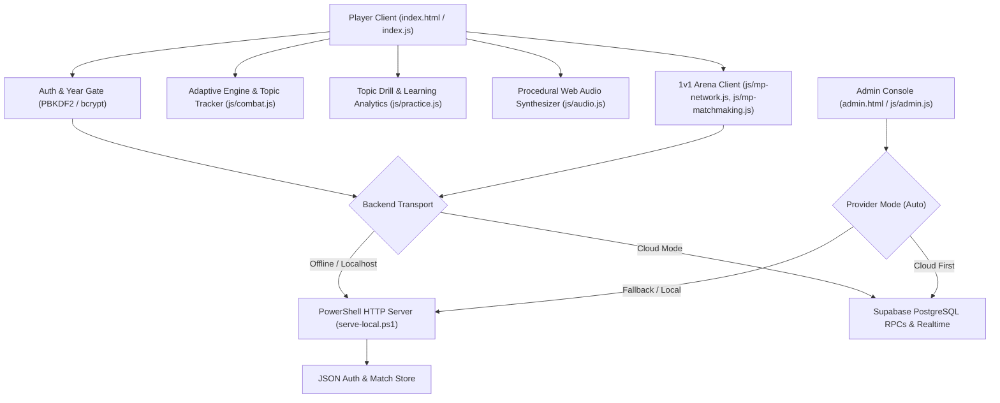

# BYTEBOUND (CITCS Quest): Comprehensive Capstone Study Documentation

> **Living Document Notice:** All technical metrics, curriculum counts, combat cards, skill trees, room tables, database schemas, API routes, file inventories, and revision logs inside `<!-- AUTO:START:* -->` blocks are automatically synchronized from the live codebase whenever changes occur. Hand-written academic narratives outside those markers are preserved intact.

## 1. Live System Snapshot

<!-- AUTO:START:snapshot -->
| Metric | Live Value |
| :--- | :--- |
| **Last Auto-Synced** | `2026-11-27 13:56:39` |
| **Git Branch / HEAD** | `main` @ `89faa30` |
| **Tracked Source Modules** | `41` files (`54,443` lines, `1962.5 KB`) |
| **Question Bank Coverage** | `240` questions across `4` disciplines & `20` topics |
| **Campaign Structure** | `16` authored rooms · `RUN_LENGTH = 32` (2 campaign loops) |
| **Achievements** | `48` tracked milestones |
| **Active Asset Cache Versions** | `styles.css?v=47`, `js/audio.js?v=15`, `js/cards.js?v=9`, `js/combat.js?v=74`, `js/practice.js?v=12`, `index.js?v=179`, `js/tutorials.js?v=15`, `admin.css?v=5`, `admin.js?v=7` |
<!-- AUTO:END:snapshot -->

---

## 2. Capstone Study Overview & Pedagogical Objectives

### 2.1 Research Context & Problem Statement
Undergraduate Information Technology and Computer Science students often struggle to sustain engagement and retain cumulative technical concepts across progressive year levels (**1st Year through 4th Year**). Static online quizzes rarely adapt to individual weaknesses, seldom distinguish **initial baseline competence** from **post-practice mastery**, and offer minimal formative feedback or classroom governance controls.

**BYTEBOUND (*CITCS Quest — Learn to Fight*)** addresses these gaps through an **Adaptive Educational Role-Playing Game (RPG)** built specifically for the CITCS curriculum. Academic mastery directly governs combat outcomes, resource recovery, skill specialization, and competitive ranking, turning formative assessment into immediate, strategic gameplay feedback.

### 2.2 Core Educational Objectives
1. **Cumulative Year-Level Scaffolding:** Enforce syllabus-aligned **Academic Year Filtering** (`Year 1` to `Year 4`) so students only encounter topics appropriate for their current academic standing, while routing year-level changes through an administrator approval workflow.
2. **Diagnostic vs. Post-Baseline Measurement:** Separate each student's first `3` attempts per topic (`BASELINE_ATTEMPTS = 3`) as a **Diagnostic Baseline** before computing **Post-Baseline Accuracy** and measurable learning gain (`+Delta%`), exportable as structured CSV datasets for capstone statistical evaluation.
3. **Adaptive Difficulty & Spaced Retrieval Practice:** Dynamically escalate or de-escalate question difficulty (`easy` → `medium` → `hard`) per discipline using streak stability and weak-topic weighting, while re-queuing missed questions via **Spaced Review** (`REVIEW_DELAY = 3`).
4. **Accountable Risk-Reward Mastery:** Tie tactical survival (`Kernel Aegis`, `Packet Lockdown`, `Overburn Execution`, `Necromancy`, and `0 MP Remedial Surge`) directly to **3–5 consecutive correct answer streaks**, penalizing careless guessing while rewarding sustained conceptual accuracy.
5. **Comprehensive Administrative & Classroom Governance:** Provide instructors/researchers with a standalone **Admin Management Console** ([admin.html](file:///c:/Users/brend/Downloads/kings-and-pigs-main%20(2)/bytebound/admin.html)) featuring verified password authentication, password-reset & year-change request queues, persistent activity logs, paginated question-bank inspection, leaderboard moderation, and live 1v1 room oversight.

---

## 3. System Architecture & Technology Stack

BYTEBOUND uses a **zero-build client-side frontend** paired with a **dual-mode backend architecture** capable of running seamlessly both offline/LAN via `serve-local.ps1` and in cloud deployment via **Supabase PostgreSQL + Realtime**.



### Key Architectural Highlights
- **Rendering & Simulation Engine:** Custom HTML5 2D Canvas engine (`index.js`) with camera clamping/expansion across multi-floor interiors, sprite animation state machines (`js/classes/Sprite.js`, `Player.js`, `Enemy.js`, `Boss.js`), polygonal & rectangular collision blocks (`js/classes/CollisionBlock.js`, `js/data/collisions.js`), and accessible Dark/Light CSS themes (`css/styles.css`).
- **Procedural Audio Engine (`js/audio.js`):** Real-time Web Audio synthesis requiring zero external `.mp3` dependencies during combat—generating tactile UI/combat SFX and adaptive looping tracks (`dashboard`, `explore` calm ambient felt bells & warm pads; `battle` chiptune-rock mix; `boss` complextro growl/reese bass with chopped breakcore drums and classical arpeggios) shaped through per-track low-pass filter buses.
- **Data Integrity & Asset Versioning:** Deterministic JSON-to-JS question compilation (`data/questions.json` → `js/data/questions.js`) paired with explicit `?v=` query strings in `index.html` and `admin.html` to eliminate stale browser caches during iterative testing.

---

## 4. Core Learning, Gameplay & Governance Systems

### 4.1 Adaptive Difficulty & Spaced Review Engine (`js/combat.js`)
- **Per-Discipline Difficulty Calibration (`AdaptiveDifficulty`):** Tracks independent difficulty tiers (`0` Easy, `1` Medium, `2` Hard) across each of the 4 CS/IT disciplines and calibrates initial tiers directly from stored `topicProgress`.
- **Escalation & Step-Down:** Two consecutive correct answers at Medium (`mediumStreak >= 2`) advance the category to Hard; any wrong answer immediately steps difficulty down by one tier and resets `mediumStreak`.
- **Weak-Topic Prioritization & Spaced Review:** Topics below `75%` accuracy receive weighted priority. Missed questions enter a bounded review queue (`REVIEW_LIMIT = 25`) and resurface after `REVIEW_DELAY = 3` subsequent answers (`REVIEW_CHANCE = 0.30` in regular battles, raised to `BOSS_REVIEW_CHANCE = 0.50` against bosses).
- **Runtime Choice Shuffling (`withShuffledChoices`):** Randomizes option positions every time a question renders without mutating `data/questions.json`, preventing positional memorization.

### 4.2 Diagnostic Baseline, Capability Radar & Research Export
- **Baseline Window:** Each topic records the player's first `3` attempts into `baselineCorrect` and `baselineAttempted`.
- **Post-Baseline Learning Gain:** Subsequent answers populate post-baseline accuracy, allowing the **Tracker (`03 · Tracker`)** view to render `+Delta%` improvement per topic, per discipline, and overall, visualized via a 4-axis SVG Capability Radar.
- **Research CSV Export:** One-click CSV export (`bytebound-learning-report-<player>.csv`) outputs structured per-topic attempt, baseline, post-baseline, accuracy delta, and adaptive tier metrics for statistical analysis.

### 4.3 Study, Campaign & Competitive Modes
1. **Campaign Mode (`index.js`):** 16 authored rooms looped up to `RUN_LENGTH = 32` encounters across 7 districts (`Data Center`, `BB Corp`, `BB Corp Street`, `Net Cafe`, `Hospital`, `Bank`, `Corp Supply`), explorable via the interactive draggable/zoomable RPG Campaign Map (`M`).
2. **Topic Drill (`02 · Topic Drill`, `js/practice.js`):** Focused non-combat study mode with `Adaptive`, `Mixed`, `Easy`, `Medium`, `Hard`, `Weak Topic Spotlight`, and `Review missed` filters. Updates baseline/post-baseline metrics and awards `1 Skill Point` per `5` correct answers without HP loss.
3. **Practice Mode:** Full sandbox combat simulation that avoids mutating saved campaign slots or leaderboard standings.
4. **1v1 Competitive Arena (`js/mp-network.js`, `js/mp-matchmaking.js`, `js/mp-ui.js`):** Synchronized real-time player-versus-player duels via Supabase Realtime Presence/Broadcast or local HTTP `/api/mp/*` polling, backed by an Elo-rated PvP leaderboard.

### 4.4 Card Combat & Streak-Charged Exclusive Active Skills
- **Full-Width Tactical Hand (`4` Cards + Optional Exclusive Relic):** Players select a card, answer an adaptive CS/IT question to resolve the action at full strength (or diminished/missed effect on failure), and manage MP and `Defend` cooldowns (`2` turns).
- **3–5 Consecutive Correct Answer Streak Charge (`hero.ultCharge`):**
  - Unlocked Exclusive Active Skills (**`Kernel Aegis`**, **`Packet Lockdown`**, **`Overburn Execution`**) always remain visible in solo combat with a 5-pip charge gauge (`0/3` → `5/5`).
  - **Below `3` Consecutive Correct:** Card remains disabled (`STREAK X/3`). Any wrong answer resets streak charge back to `0`.
  - **`3/5` (`READY`):** Enables the Exclusive Skill at **`1.0×` base power**.
  - **`4/5` (`OVERCHARGED`):** Boosts damage, MP gain, buff magnitude, and stun duration to **`1.25×`**.
  - **`5/5` (`MAX OVERDRIVE`):** Maximizes skill output at **`1.5×`**, consuming the streak charge (`5 → 0`) upon activation without self-charging on that cast turn.
- **Database Exclusive (`Necromancy`):** Passive-slot capstone (`activeCardId: null`) allowing players to spend MP to raise up to `3` defeated enemies/bosses as sequential undead allies that strike after correct answers.
- **`0 MP` Remedial Surge Recovery:** Prevents soft-locks when out of MP by letting the player answer `2–5` foundational/missed remedial questions for full MP + `35%` HP + `+8 ATK / +4 DEF` on a perfect score, or proportional recovery if at least one answer is correct.

### 4.5 Academic Year Restrictions & Approval Workflow
- Players select their enrolling Academic Year (`Year 1`–`Year 4`) at registration; gameplay filters all questions via `isQuestionEligibleForYear(question, cap)` across campaign combat, remedial drills, Topic Drills, and multiplayer question selection.
- Free client-side switching is intentionally locked in Settings so students cannot artificially inflate scores using lower-year questions; students must submit a **Year Change Request** (`request-year-change` / `auth_request_year_change`) reviewed and approved/dismissed by an administrator.

---

## 5. Curriculum & Question Bank Matrix

> Questions are stored in [`data/questions.json`](file:///c:/Users/brend/Downloads/kings-and-pigs-main%20(2)/bytebound/data/questions.json) and compiled into [`js/data/questions.js`](file:///c:/Users/brend/Downloads/kings-and-pigs-main%20(2)/bytebound/js/data/questions.js) via `node scripts/build-questions.js`.

<!-- AUTO:START:questions -->
- **Total Questions:** `240` (`80` Easy · `80` Medium · `80` Hard)
- **Academic Year Distribution:** Year 1: `45` · Year 2: `86` · Year 3: `89` · Year 4: `20`

| Discipline | Topic | Easy | Medium | Hard | Total | Years |
| :--- | :--- | :---: | :---: | :---: | :---: | :--- |
| Computer Systems | Computer Architecture | 4 | 4 | 4 | **12** | Y2, Y3, Y4 |
| Computer Systems | Computer Fundamentals | 4 | 4 | 4 | **12** | Y1, Y2, Y3 |
| Computer Systems | Memory & Storage Systems | 4 | 4 | 4 | **12** | Y1, Y2, Y3 |
| Computer Systems | Number Systems | 4 | 4 | 4 | **12** | Y1, Y2 |
| Computer Systems | Operating Systems | 4 | 4 | 4 | **12** | Y3 |
| Database | Data Modeling & Normalization | 4 | 4 | 4 | **12** | Y2, Y3, Y4 |
| Database | Databases | 4 | 4 | 4 | **12** | Y2, Y4 |
| Database | Indexing & Performance | 4 | 4 | 4 | **12** | Y3, Y4 |
| Database | SQL Queries | 4 | 4 | 4 | **12** | Y2, Y3 |
| Database | Transactions & Concurrency | 4 | 4 | 4 | **12** | Y3, Y4 |
| Networking & Security | Cryptography & Authentication | 4 | 4 | 4 | **12** | Y3, Y4 |
| Networking & Security | Information Security | 4 | 4 | 4 | **12** | Y1, Y2, Y4 |
| Networking & Security | Network Defense & Firewalls | 4 | 4 | 4 | **12** | Y1, Y3, Y4 |
| Networking & Security | Network Models & Protocols | 4 | 4 | 4 | **12** | Y3, Y4 |
| Networking & Security | Networking | 4 | 4 | 4 | **12** | Y1, Y2, Y3, Y4 |
| Programming | Algorithms | 4 | 4 | 4 | **12** | Y2, Y3 |
| Programming | Concurrency | 4 | 4 | 4 | **12** | Y3, Y4 |
| Programming | Data Structures | 4 | 4 | 4 | **12** | Y1, Y2, Y3 |
| Programming | Object-Oriented Programming | 4 | 4 | 4 | **12** | Y1, Y2 |
| Programming | Programming | 4 | 4 | 4 | **12** | Y1, Y2 |
<!-- AUTO:END:questions -->

---

## 6. Combat Cards, Exclusive Active Skills & Discipline Skill Trees

<!-- AUTO:START:combat -->
### Key Adaptive & Streak Mechanics Constants (`js/combat.js`)
- **Review Scheduling:** `REVIEW_CHANCE = 0.3` · `BOSS_REVIEW_CHANCE = 0.5` · `REVIEW_DELAY = 3` answers · `REVIEW_LIMIT = 25`
- **Diagnostic & Skill Economy:** `BASELINE_ATTEMPTS = 3` attempts/topic · `SKILL_POINT_INTERVAL = 5` correct answers/SP · `DEFEND_COOLDOWN_TURNS = 2`
- **Exclusive Skill Streak Charge:** Unlocks at `EXCLUSIVE_MIN_STREAK = 3` consecutive correct (`1.0×`), overcharges at `4` (`1.25×`), peaks at `EXCLUSIVE_MAX_STREAK = 5` (`1.5× Max Overdrive`), resets to `0` on any wrong answer or cast.

### Combat Card Library (`13` Cards — `js/cards.js`)
| ID | Card | Base Cost | Kind | Pool | Effect Summary |
| :--- | :--- | :--- | :--- | :--- | :--- |
| `strike` | **Strike** | 0 MP | `hit` | Starter Deck | Base attack damage. |
| `power` | **Power Strike** | Empower (20+ MP) | `hit` | Starter Deck | Costs mana for 1.5x damage. |
| `defend` | **Defend** | 0 MP | `defend` | Starter Deck | Blocks most of the next hit. 2-turn cooldown. |
| `charge` | **Charge Mana** | 0 MP | `charge` | Starter Deck | Restores mana. |
| `quick` | **Quick Jab** | 0 MP | `hit` | Unlockable Reward | A weaker hit that restores 3 mana when correct. |
| `mend` | **Mend** | 0 MP | `heal` | Unlockable Reward | Restores HP when correct. |
| `siphon` | **Siphon** | 0 MP | `mana` | Unlockable Reward | Restores 8 mana when correct. |
| `heavy` | **Heavy Blow** | 30 MP | `hit` | Unlockable Reward | Costs 30 mana for a crushing hit. |
| `fortify` | **Fortify** | 0 MP | `buff` | Unlockable Reward | +2 defense for the rest of the battle. |
| `overclock` | **Overclock** | 10 MP | `hit` | Unlockable Reward | Costs 10 mana. Double damage when correct. |
| `kernel_aegis` | **Kernel Aegis** | 10 MP | `aegis` | Exclusive (3–5 Streak) | Charges via 3–5 answer streak (up to 1.5x). Blocks hits + full heal + 40–60 MP + surge; wrong answers drain/pierce. |
| `packet_lockdown` | **Packet Lockdown** | 10 MP | `stun` | Exclusive (3–5 Streak) | Charges via 3–5 answer streak (up to 1.5x). 8–12t stun, breach DMG, +50% hit DMG while stunned & MP. |
| `plasma_compile` | **Overburn Execution** | 15 MP | `burn_hit` | Exclusive (3–5 Streak) | Charges via 3–5 answer streak (up to 1.5x). Heavy DMG (Execute <40% HP) + Inferno Burn (5t). |

### Discipline Skill Trees (`28` Nodes — `js/combat.js`)
| Discipline | Skill Node | Type | Live Effect Summary |
| :--- | :--- | :--- | :--- |
| Computer Systems | Hardware Tuning | Passive | +1 ATK per rank |
| Computer Systems | OS Stability | Passive | +1 DEF per rank |
| Computer Systems | **★ Kernel Aegis** | Exclusive (Max R3) | Active Skill: Shield Normal Hits + Full Heal + Surge (3–5 Streak Charge) |
| Computer Systems | Recovery Protocol | Passive | +2 HP per correct answer per rank |
| Computer Systems | Virtualization | Passive | +5 max HP per rank |
| Computer Systems | Thermal Control | Passive | +2 DEF per rank |
| Computer Systems | Firmware Overclock | Passive | +2 ATK and +2 max HP per rank |
| Networking & Security | Firewall | Passive | +1 DEF per rank |
| Networking & Security | Threat Analysis | Passive | +1 ATK per rank |
| Networking & Security | **★ Packet Lockdown** | Exclusive (Max R3) | Active Skill: Stun + Breach DMG + 1.5x Vulnerable (3–5 Streak Charge) |
| Networking & Security | Secure Channel | Passive | +2 MP per correct answer per rank |
| Networking & Security | Intrusion Detection | Passive | +1 ATK and +1 DEF per rank |
| Networking & Security | Packet Routing | Passive | +5 max MP per rank |
| Networking & Security | Zero Trust | Passive | +3 HP per correct answer per rank |
| Programming | Algorithm Efficiency | Passive | +1 ATK per rank |
| Programming | Error Handling | Passive | +1 DEF per rank |
| Programming | **★ Overburn Execution** | Exclusive (Max R3) | Active Skill: Massive DMG (Execute) & Burn/t (3–5 Streak Charge) |
| Programming | Code Reuse | Passive | +2 HP per correct answer per rank |
| Programming | Concurrency | Passive | +2 MP per correct answer per rank |
| Programming | Runtime Optimization | Passive | +1 ATK and +1 DEF per rank |
| Programming | Compiler Mastery | Passive | +2 ATK per rank |
| Database | Query Indexing | Passive | +1 ATK per rank |
| Database | Transaction Safety | Passive | +1 DEF per rank |
| Database | **★ Necromancy** | Exclusive (Max R3) | Max Undead Allies: 1 per rank (up to 3 · Costs MP) |
| Database | Query Cache | Passive | +2 MP per correct answer per rank |
| Database | Replication | Passive | +5 max MP per rank |
| Database | Query Optimizer | Passive | +1 ATK and +1 DEF per rank |
| Database | ACID Guarantee | Passive | +3 HP per correct answer per rank |
<!-- AUTO:END:combat -->

---

## 7. World Progression, Biomes, Boss Encounters & Achievements

- **Collision & Movement Fixes:** Multi-floor interiors (including `Room 02: Server Shaft` in `js/data/collisions.js` paired with horizontal pushout bounds in `js/classes/Player.js`) enforce watertight wall/platform boundaries to prevent out-of-bounds traversal or geometry snagging.
- **Guided Onboarding (`js/tutorials.js`):** `17` interactive tours and contextual gameplay lessons tracked toward the `Codex Laureate` achievement.

<!-- AUTO:START:world -->
- **Campaign Structure:** `16` unique rooms looped up to `RUN_LENGTH = 32` encounters (`32` rooms across `2` loops). Mini Boss **Kor** guards `Executive Floor` (Room `5`), **Grenu** spawns in `Control Deck 2` (Loop 2), and **Final Boss King Crolue** guards all 4 branch finales (Rooms `9`, `12`, `14`, `16`).
- **Achievements Breakdown (`48` Total):** General: `17` · Study/Tracker/Leaderboard: `12` · 1v1 PvP: `8` · Exclusive Mastery: `10` · Onboarding (`Codex Laureate`): `1`.

| Room | Name | District / Theme | Enemies (`pigs`) | Boss / Finale Checkpoint |
| :---: | :--- | :--- | :---: | :--- |
| 01 | **Terminal Bay** | `datacenter` | 2 | — |
| 02 | **Server Shaft** | `datacenter` | 3 | — |
| 03 | **Control Deck** | `datacenter` | 2 | Loop 2 Mini Boss **Grenu** |
| 04 | **Office Wing** | `bbcorp` | 3 | — |
| 05 | **Executive Floor** | `bbcorp` | 3 | Mini Boss **Kor** |
| 06 | **BB Corp Street** | `mainroad` | 3 | — |
| 07 | **Net Cafe Street** | `mainroad` | 3 | — |
| 08 | **Net Cafe Lobby** | `netcafe` | 3 | — |
| 09 | **Net Cafe Staff Room** | `netcafe` | 3 | Branch Finale / **King Crolue** |
| 10 | **East Main Road** | `mainroad` | 3 | — |
| 11 | **Hospital Wing** | `hospital` | 3 | — |
| 12 | **Hospital Upper Floors** | `hospital` | 3 | Branch Finale / **King Crolue** |
| 13 | **Bank** | `bank` | 3 | — |
| 14 | **Bank Upper Floors** | `bank` | 3 | Branch Finale / **King Crolue** |
| 15 | **Corp Supply** | `supply` | 3 | — |
| 16 | **Corp Supply Management** | `supply` | 3 | Branch Finale / **King Crolue** |
<!-- AUTO:END:world -->

---

## 8. Authentication, Security & Comprehensive Admin Console

### 8.1 Player & Admin Security Architecture
- **Password Authentication:** Player accounts use salted **PBKDF2-SHA256** hashes on the local PowerShell server (`serve-local.ps1`) and **PostgreSQL `pgcrypto` bcrypt** salted hashes inside private `public.user_credentials` with opaque session tokens (`public.user_sessions`) in Supabase (`supabase/migration-password-auth.sql`).
- **Forgot-Password Validation:** Reset requests are strictly validated against existing usernames on both backend tiers—requests targeting non-existent accounts are rejected with an explicit error and never pollute the admin queue.
- **High-Concurrency Rate Limiting & Traffic Throttling:**
  - **Server & Database Guards:** Both `serve-local.ps1` (HTTP `429` + `Retry-After` sliding window) and `supabase/migration-rate-limiting.sql` (`public.api_rate_limits`) limit failed login/admin attempts (`5 / 15 min`), forgot-password & year-change requests (`3 / 10 min`), signups (`10 / 10 min`), and rapid leaderboard writes (`1 / 5s`).
  - **Client Backoff, Caching & Lazy Sockets:** `supabaseRequest()` retries `429`/`503` responses with exponential backoff + jitter; profile/leaderboard syncs coalesce over `15–20s` milestones with offline recovery queues and `45s` leaderboard TTL caching; and 1v1 Multiplayer Realtime/LAN polling connects lazily (`1500ms` lobby, `450ms` active match, `idle` with `0` traffic when closed).

### 8.2 Admin Management Console (`admin.html` & `js/admin.js`)
Designed for readable, instructor-friendly operation with **Auto (`Cloud DB → Local Server`)** connection fallback:
- **Dashboard (`overview`):** KPI cards, recent account signups, pending request counts, active 1v1 rooms, and audit feed.
- **Accounts (`users`):** Search/filter users, create accounts, inspect detailed player progress/skills/stats modals, edit Academic Year directly, issue temporary passwords, revoke sessions, suspend/unsuspend accounts, reset run progress, or delete users.
- **Requests (`resets`):** Actionable inbox recording both **Forgot-Password Requests** and **Academic Year Change Requests** with one-click approval, custom temporary password assignment, or dismissal.
- **Questions (`questions`):** Full searchable/filterable browser for the compiled question bank with **numbered pagination (`1 … N`)** so overflowed datasets remain accessible page-by-page.
- **Leaderboards & Multiplayer (`leaderboards`, `multiplayer`):** Inspect/moderate Arcade and 1v1 Elo standings and close stale multiplayer rooms.
- **Activity Log (`audit`):** Persistent timestamped audit trail recording account signups, password/year requests, and administrative actions across sessions.

<!-- AUTO:START:backend -->
### Local Server HTTP Endpoints (`serve-local.ps1` — `32` Routes)
- **Player Auth & Requests (`11`):** `/api/auth/change-password`, `/api/auth/forgot-password`, `/api/auth/health`, `/api/auth/login`, `/api/auth/logout`, `/api/auth/mirror-account`, `/api/auth/profile`, `/api/auth/request-year-change`, `/api/auth/reset`, `/api/auth/session`, `/api/auth/signup`
- **Admin Console API (`16`):** `/api/admin/approve-year-request`, `/api/admin/close-room`, `/api/admin/create-user`, `/api/admin/delete-pvp-entry`, `/api/admin/delete-user`, `/api/admin/dismiss-reset-request`, `/api/admin/dismiss-year-request`, `/api/admin/log-activity`, `/api/admin/login`, `/api/admin/logout`, `/api/admin/overview`, `/api/admin/reset-password`, `/api/admin/reset-progress`, `/api/admin/revoke-sessions`, `/api/admin/set-user-year`, `/api/admin/toggle-suspend`
- **Multiplayer & PvP API (`5`):** `/api/mp/event`, `/api/mp/pvp-leaderboard`, `/api/mp/pvp-reset`, `/api/mp/pvp-result`, `/api/mp/state`

### Supabase PostgreSQL Migrations (`12` Tables · `32` RPC Functions across `9` Files)
| Migration Script | Tables Created / Referenced | RPC Functions Defined |
| :--- | :--- | :--- |
| `supabase/migration-1v1-leaderboard.sql` | `pvp_leaderboard_entries` | `submit_leaderboard_run()`, `submit_pvp_match_result()`, `reset_user_profile()` |
| `supabase/migration-admin-console.sql` | `password_reset_requests`, `year_change_requests`, `admin_accounts`, `admin_sessions`, `admin_audit_logs` | `_serialize_auth_user()`, `_resolve_session_user_id()`, `auth_log_in()`, `auth_request_year_change()`, `auth_request_password_reset()`, `auth_change_password()`, `_resolve_admin_session()`, `admin_log_in()`, `admin_get_overview()`, `admin_create_user()`, `admin_reset_user_password()`, `admin_dismiss_reset_request()`, `admin_set_user_year()`, `admin_approve_year_request()`, `admin_dismiss_year_request()`, `admin_toggle_suspend_user()`, `admin_reset_user_progress()`, `admin_revoke_user_sessions()`, `admin_delete_user()`, `admin_delete_leaderboard_entry()` |
| `supabase/migration-cleanup-users-and-sss-pin.sql` | — | — |
| `supabase/migration-leaderboard-run-checks.sql` | `users`, `leaderboard_entries` | `upsert_user_profile()`, `reset_user_profile()`, `submit_leaderboard_run()` |
| `supabase/migration-password-auth.sql` | `user_credentials`, `user_sessions` | `_serialize_auth_user()`, `_resolve_session_user_id()`, `auth_sign_up()`, `auth_log_in()`, `auth_get_session()`, `auth_logout()`, `auth_save_profile()`, `auth_reset_profile()`, `submit_leaderboard_run()`, `submit_pvp_match_result()` |
| `supabase/migration-profile-pin.sql` | — | `upsert_user_profile()`, `reset_user_profile()` |
| `supabase/migration-rate-limiting.sql` | `api_rate_limits` | `_check_rate_limit()`, `_clear_rate_limit()`, `auth_log_in()`, `auth_request_password_reset()`, `auth_request_year_change()`, `admin_log_in()`, `submit_leaderboard_run()` |
| `supabase/migration-unique-username-no-password.sql` | — | `register_user_profile()`, `upsert_user_profile()`, `reset_user_profile()` |
| `supabase/schema.sql` | `users`, `leaderboard_entries`, `multiplayer_rooms`, `pvp_leaderboard_entries` | `submit_leaderboard_run()`, `submit_pvp_match_result()` |
<!-- AUTO:END:backend -->

---

## 9. Codebase Architecture & Module Inventory

<!-- AUTO:START:inventory -->
| File Path | Lines | Size (KB) | Functional Role |
| :--- | :---: | :---: | :--- |
| [`CHANGES.md`](file:///C:/Users/brend/Downloads/kings-and-pigs-main%20(2)/bytebound/CHANGES.md) | 58 | 9.4 | Concise changelog and migration overview aligned with live system revisions |
| [`SUPABASE_SETUP.md`](file:///C:/Users/brend/Downloads/kings-and-pigs-main%20(2)/bytebound/SUPABASE_SETUP.md) | 23 | 2.9 | Cloud PostgreSQL and Realtime setup instructions |
| [`admin.html`](file:///C:/Users/brend/Downloads/kings-and-pigs-main%20(2)/bytebound/admin.html) | 146 | 6.4 | Standalone Administrator Management Console shell and layout containers |
| [`css/admin.css`](file:///C:/Users/brend/Downloads/kings-and-pigs-main%20(2)/bytebound/css/admin.css) | 1,137 | 21.3 | Styling and responsive grid layouts for the standalone Admin Management Console |
| [`css/styles.css`](file:///C:/Users/brend/Downloads/kings-and-pigs-main%20(2)/bytebound/css/styles.css) | 14,591 | 393.9 | Complete responsive design system (Dark/Light themes, battle cards, skill tree, portrait/landscape media queries) |
| [`data/questions.json`](file:///C:/Users/brend/Downloads/kings-and-pigs-main%20(2)/bytebound/data/questions.json) | 3,369 | 125.9 | Authoritative 240-question curriculum bank tagged by category, topic, year (1–4), and difficulty |
| [`index.html`](file:///C:/Users/brend/Downloads/kings-and-pigs-main%20(2)/bytebound/index.html) | 415 | 27.3 | Main player SPA shell (Auth, Quest Hub, Practice, Battle Canvas, Tracker, Maps, Skill Tree, Settings) |
| [`index.js`](file:///C:/Users/brend/Downloads/kings-and-pigs-main%20(2)/bytebound/index.js) | 10,133 | 402.5 | Game loop, 16-room engine, sprite/animation rendering, physics, save profiles, auth flows, achievements, Hub UI |
| [`js/admin.js`](file:///C:/Users/brend/Downloads/kings-and-pigs-main%20(2)/bytebound/js/admin.js) | 2,130 | 93.2 | Admin Console client controller (Supabase RPC + local server fallback, pagination, requests, logs, CRUD) |
| [`js/arena.js`](file:///C:/Users/brend/Downloads/kings-and-pigs-main%20(2)/bytebound/js/arena.js) | 101 | 3.3 | Battle arena biome canvas backdrop rendering themes |
| [`js/audio.js`](file:///C:/Users/brend/Downloads/kings-and-pigs-main%20(2)/bytebound/js/audio.js) | 974 | 33.2 | Procedural Web Audio synthesizer: SFX + adaptive BGM (ambient explore, chiptune-rock battle, complextro-classical boss) |
| [`js/cards.js`](file:///C:/Users/brend/Downloads/kings-and-pigs-main%20(2)/bytebound/js/cards.js) | 157 | 9.5 | CARD_LIBRARY definitions, mana costs, dynamic damage/buff descriptions, and card role metadata |
| [`js/classes/Boss.js`](file:///C:/Users/brend/Downloads/kings-and-pigs-main%20(2)/bytebound/js/classes/Boss.js) | 259 | 10.0 | Mini Boss (Kor, Grenu) and Final Boss (King Crolue) combat stats and sprite state machines |
| [`js/classes/CollisionBlock.js`](file:///C:/Users/brend/Downloads/kings-and-pigs-main%20(2)/bytebound/js/classes/CollisionBlock.js) | 34 | 0.9 | Axis-aligned and polygonal collision platform/wall primitives |
| [`js/classes/Enemy.js`](file:///C:/Users/brend/Downloads/kings-and-pigs-main%20(2)/bytebound/js/classes/Enemy.js) | 395 | 15.7 | Enemy patrol AI, sprite states, and encounter triggers |
| [`js/classes/Player.js`](file:///C:/Users/brend/Downloads/kings-and-pigs-main%20(2)/bytebound/js/classes/Player.js) | 280 | 8.6 | Player movement, gravity, horizontal/vertical collision pushout, sprite states, and door interaction |
| [`js/classes/Sprite.js`](file:///C:/Users/brend/Downloads/kings-and-pigs-main%20(2)/bytebound/js/classes/Sprite.js) | 157 | 4.7 | Frame-based sprite sheet loader and animation renderer |
| [`js/combat.js`](file:///C:/Users/brend/Downloads/kings-and-pigs-main%20(2)/bytebound/js/combat.js) | 3,443 | 139.4 | AdaptiveDifficulty engine, spaced review, Academic Year gating, Skill Trees, card combat, 3–5 streak exclusive skills |
| [`js/data/collisions.js`](file:///C:/Users/brend/Downloads/kings-and-pigs-main%20(2)/bytebound/js/data/collisions.js) | 294 | 16.6 | Compiled platform, wall, and conveyor collision geometry for all 16 authored rooms |
| [`js/data/questions.js`](file:///C:/Users/brend/Downloads/kings-and-pigs-main%20(2)/bytebound/js/data/questions.js) | 3,372 | 126.1 | Compiled browser-ready QUESTION_BANK bundle generated from data/questions.json |
| [`js/eventListeners.js`](file:///C:/Users/brend/Downloads/kings-and-pigs-main%20(2)/bytebound/js/eventListeners.js) | 231 | 9.0 | Keyboard and battle hotkey dispatchers across explore, map, skill tree, and combat phases |
| [`js/font.js`](file:///C:/Users/brend/Downloads/kings-and-pigs-main%20(2)/bytebound/js/font.js) | 7 | 0.1 | Local bitmap/pixel webfont loader and fallback registration |
| [`js/mp-matchmaking.js`](file:///C:/Users/brend/Downloads/kings-and-pigs-main%20(2)/bytebound/js/mp-matchmaking.js) | 765 | 27.2 | 1v1 competitive room creation, invitation codes, Elo rating updates, and match lifecycle |
| [`js/mp-network.js`](file:///C:/Users/brend/Downloads/kings-and-pigs-main%20(2)/bytebound/js/mp-network.js) | 1,439 | 54.1 | Cross-device Supabase Realtime + local HTTP 1v1 lobby, presence, and broadcast synchronization |
| [`js/mp-ui.js`](file:///C:/Users/brend/Downloads/kings-and-pigs-main%20(2)/bytebound/js/mp-ui.js) | 862 | 38.6 | 1v1 Multiplayer lobby browser, room drawer, and HUD controls |
| [`js/practice.js`](file:///C:/Users/brend/Downloads/kings-and-pigs-main%20(2)/bytebound/js/practice.js) | 595 | 25.4 | Non-combat Topic Drill study mode with Adaptive/Mixed/Tier filters and tracker updates |
| [`js/tutorials.js`](file:///C:/Users/brend/Downloads/kings-and-pigs-main%20(2)/bytebound/js/tutorials.js) | 3,457 | 136.6 | 17 guided interactive page tours and onboarding lessons with Codex Laureate tracking |
| [`js/utils.js`](file:///C:/Users/brend/Downloads/kings-and-pigs-main%20(2)/bytebound/js/utils.js) | 30 | 0.6 | Shared collision polygon, array, and canvas helper utilities |
| [`scripts/build-questions.js`](file:///C:/Users/brend/Downloads/kings-and-pigs-main%20(2)/bytebound/scripts/build-questions.js) | 109 | 4.3 | Validates data/questions.json schema/coverage, compiles js/data/questions.js, and triggers doc sync |
| [`serve-local.cmd`](file:///C:/Users/brend/Downloads/kings-and-pigs-main%20(2)/bytebound/serve-local.cmd) | 5 | 0.1 | Windows one-click launcher for serve-local.ps1 |
| [`serve-local.ps1`](file:///C:/Users/brend/Downloads/kings-and-pigs-main%20(2)/bytebound/serve-local.ps1) | 1,948 | 87.9 | Zero-dependency PowerShell HTTP server with PBKDF2-SHA256 Auth API, Admin API, and LAN 1v1 Multiplayer API |
| [`supabase-config.js`](file:///C:/Users/brend/Downloads/kings-and-pigs-main%20(2)/bytebound/supabase-config.js) | 5 | 0.1 | Supabase project URL and publishable/anon key configuration |
| [`supabase/migration-1v1-leaderboard.sql`](file:///C:/Users/brend/Downloads/kings-and-pigs-main%20(2)/bytebound/supabase/migration-1v1-leaderboard.sql) | 235 | 10.4 | Supabase SQL schema / migration script |
| [`supabase/migration-admin-console.sql`](file:///C:/Users/brend/Downloads/kings-and-pigs-main%20(2)/bytebound/supabase/migration-admin-console.sql) | 849 | 35.0 | Supabase SQL schema / migration script |
| [`supabase/migration-cleanup-users-and-sss-pin.sql`](file:///C:/Users/brend/Downloads/kings-and-pigs-main%20(2)/bytebound/supabase/migration-cleanup-users-and-sss-pin.sql) | 27 | 1.0 | Supabase SQL schema / migration script |
| [`supabase/migration-leaderboard-run-checks.sql`](file:///C:/Users/brend/Downloads/kings-and-pigs-main%20(2)/bytebound/supabase/migration-leaderboard-run-checks.sql) | 387 | 12.4 | Supabase SQL schema / migration script |
| [`supabase/migration-password-auth.sql`](file:///C:/Users/brend/Downloads/kings-and-pigs-main%20(2)/bytebound/supabase/migration-password-auth.sql) | 634 | 21.3 | Supabase SQL schema / migration script |
| [`supabase/migration-profile-pin.sql`](file:///C:/Users/brend/Downloads/kings-and-pigs-main%20(2)/bytebound/supabase/migration-profile-pin.sql) | 164 | 5.0 | Supabase SQL schema / migration script |
| [`supabase/migration-rate-limiting.sql`](file:///C:/Users/brend/Downloads/kings-and-pigs-main%20(2)/bytebound/supabase/migration-rate-limiting.sql) | 490 | 17.2 | Supabase SQL schema / migration script |
| [`supabase/migration-unique-username-no-password.sql`](file:///C:/Users/brend/Downloads/kings-and-pigs-main%20(2)/bytebound/supabase/migration-unique-username-no-password.sql) | 243 | 7.2 | Supabase SQL schema / migration script |
| [`supabase/schema.sql`](file:///C:/Users/brend/Downloads/kings-and-pigs-main%20(2)/bytebound/supabase/schema.sql) | 493 | 18.0 | Supabase SQL schema / migration script |
<!-- AUTO:END:inventory -->

---

## 10. Setup, Editing & Live Auto-Documentation Workflow

### 10.1 Running Locally & Rebuilding Questions
1. Launch `serve-local.cmd` (`serve-local.ps1`) to serve the game and admin panel over `localhost` with full offline Auth, Admin, Web Audio BGM, and LAN 1v1 support.
2. When modifying quiz items in `data/questions.json`, run:
   ```bash
   node scripts/build-questions.js
   ```
   This validates all 4 choices, uniqueness, explanations, `year` (`1–4`), compiles `js/data/questions.js`, and automatically syncs `CAPSTONE_DOCUMENTATION.md`.

### 10.2 How Automatic Documentation Sync Works (4 Active Triggers)
[`CAPSTONE_DOCUMENTATION.md`](file:///c:/Users/brend/Downloads/kings-and-pigs-main%20(2)/bytebound/CAPSTONE_DOCUMENTATION.md) stays synchronized through four layered automation paths powered by [`scripts/update-capstone-docs.js`](file:///c:/Users/brend/Downloads/kings-and-pigs-main%20(2)/bytebound/scripts/update-capstone-docs.js):
1. **AI Agent Post-Edit Hook ([`.agents/hooks.json`](file:///c:/Users/brend/Downloads/kings-and-pigs-main%20(2)/bytebound/.agents/hooks.json)) + Workspace Rule ([`GEMINI.md`](file:///c:/Users/brend/Downloads/kings-and-pigs-main%20(2)/bytebound/GEMINI.md)):** Every `edit_file` or `write_file` call made during AI sessions triggers `--from-hook` automatically, and `GEMINI.md` directs the AI to update narrative sections + attach meaningful `--note` summaries when introducing new features or design changes.
2. **Question Bank Build Hook (`scripts/build-questions.js`):** Rebuilding the curriculum question bank automatically updates Section 5's counts and topic matrix.
3. **Git Pre-Commit Hook ([`.git/hooks/pre-commit`](file:///c:/Users/brend/Downloads/kings-and-pigs-main%20(2)/bytebound/.git/hooks/pre-commit)):** Whenever you commit changes via Git, documentation metrics and revision history refresh and stage automatically.
4. **Live Manual File Watcher (`scripts/watch-capstone-docs.cmd`):** Double-click `scripts/watch-capstone-docs.cmd` (or run `node scripts/update-capstone-docs.js --watch`) while editing files manually in VS Code / Notepad++ to auto-sync `CAPSTONE_DOCUMENTATION.md` within `700ms` of any save.

---

## 11. Automated Revision & Change History

<!-- AUTO:START:revisions -->
| Timestamp | Trigger | Changed Areas / Files | Revision Summary |
| :--- | :--- | :--- | :--- |
| `2026-11-27 13:45:01` | `manual` | Documentation Sync | Defer multiplayer network connection until opening 1v1 Multiplayer so solo players generate zero lobby traffic |
| `2026-11-27 13:44:49` | `agent-edit` | 1v1 Multiplayer (`js/mp-ui.js`) | Auto-synced after agent update to `js/mp-ui.js`. |
| `2026-11-27 13:43:57` | `manual` | Documentation Sync | Implemented full client & server rate limiting, exponential backoff, lazy multiplayer sockets, and SQL rate-limit migration |
| `2026-11-27 13:43:33` | `agent-edit` | Documentation/Config (`CHANGES.md`) | Auto-synced after agent update to `CHANGES.md`. |
| `2026-11-27 13:43:31` | `agent-edit` | Documentation/Config (`SUPABASE_SETUP.md`) | Auto-synced after agent update to `SUPABASE_SETUP.md`. |
| `2026-11-27 13:43:28` | `agent-edit` | Admin Console (`admin.html`) | Auto-synced after agent update to `admin.html`. |
| `2026-11-27 13:43:26` | `agent-edit` | UI Shell & Styling (`index.html`) | Auto-synced after agent update to `index.html`. |
| `2026-11-27 13:42:44` | `agent-edit` | Admin Console (`js/admin.js`) | Auto-synced after agent update to `js/admin.js`. |
| `2026-11-27 13:41:35` | `agent-edit` | Core Engine & Hub (`index.js`) | Auto-synced after agent update to `index.js`. |
| `2026-11-27 13:41:29` | `agent-edit` | 1v1 Multiplayer (`js/mp-network.js`) | Auto-synced after agent update to `js/mp-network.js`. |
| `2026-11-27 13:41:13` | `agent-edit` | Core Engine & Hub (`index.js`) | Auto-synced after agent update to `index.js`. |
| `2026-11-27 13:41:09` | `agent-edit` | 1v1 Multiplayer (`js/mp-network.js`) | Auto-synced after agent update to `js/mp-network.js`. |
| `2026-11-27 13:41:04` | `agent-edit` | 1v1 Multiplayer (`js/mp-matchmaking.js`) | Auto-synced after agent update to `js/mp-matchmaking.js`. |
| `2026-11-27 13:40:40` | `agent-edit` | 1v1 Multiplayer (`js/mp-ui.js`) | Auto-synced after agent update to `js/mp-ui.js`. |
| `2026-11-27 13:40:38` | `agent-edit` | 1v1 Multiplayer (`js/mp-network.js`) | Auto-synced after agent update to `js/mp-network.js`. |
| `2026-11-27 13:40:06` | `agent-edit` | Combat & Exclusive Skills (`js/combat.js`) | Auto-synced after agent update to `js/combat.js`. |
| `2026-11-27 13:39:11` | `agent-edit` | Auth, Backend & SQL Schema (`serve-local.ps1`) | Auto-synced after agent update to `serve-local.ps1`. |
| `2026-11-27 13:38:58` | `agent-edit` | Auth, Backend & SQL Schema (`supabase/migration-rate-limiting.sql`) | Auto-synced after agent update to `supabase/migration-rate-limiting.sql`. |
| `2026-11-27 13:38:55` | `agent-edit` | Auth, Backend & SQL Schema (`serve-local.ps1`) | Auto-synced after agent update to `serve-local.ps1`. |
| `2026-11-27 13:29:06` | `manual` | Documentation Sync | Updated login, sign-up, and password input fonts to case-distinct monospace/sans-serif for clear uppercase/lowercase visibility |
| `2026-11-27 13:28:33` | `agent-edit` | UI Shell & Styling (`index.html`) | Auto-synced after agent update to `index.html`. |
| `2026-11-27 13:28:28` | `agent-edit` | UI Shell & Styling (`css/styles.css`) | Auto-synced after agent update to `css/styles.css`. |
| `2026-11-27 13:11:54` | `build-questions` | Documentation Sync | Rebuilt question bank (240 questions: Y1:45 Y2:86 Y3:89 Y4:20). |
| `2026-11-27 13:11:53` | `manual` | Documentation Sync | Initial generation of live auto-updating Capstone Study Documentation |
| `2026-11-27 13:11:53` | `baseline-sync` | Exclusive Active Skills, Battle Panel Layout | Removed standalone Ultimate move; moved 3–5 consecutive correct streak scaling (1.0× / 1.25× / 1.5×) directly onto Exclusive Active Skills and fixed battle `.actions` full-width grid alignment. |
| `2026-11-26 (Prior Milestone)` | `milestone` | Admin Console, Question Bank Pagination, Activity Log | Added comprehensive standalone Admin Console (`admin.html`, `js/admin.js`, `migration-admin-console.sql`), non-existent forgot-password rejection, persistent Activity Log, and Question Bank page 1..N pagination. |
| `2026-11-25 (Prior Milestone)` | `milestone` | Adaptive BGM Audio & Room 02 Collisions | Added adaptive Web Audio BGM (ambient menu/explore, chiptune-rock battle, complextro-breakcore-classical boss themes) and fixed Room 02 platform/wall watertight collisions. |
| `2026-11-24 (Prior Milestone)` | `milestone` | Academic Year Restrictions & Password Auth | Restored bcrypt/PBKDF2 password authentication (`migration-password-auth.sql`) and enforced Academic Year 1–4 progression filtering with Admin-approved year change requests. |
<!-- AUTO:END:revisions -->
