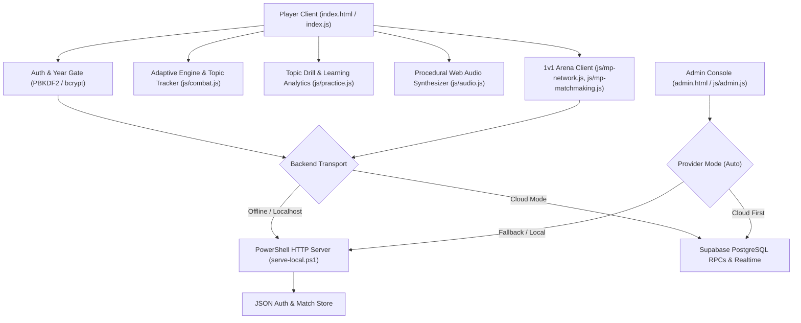

# BYTEBOUND (CITCS Quest): Comprehensive Capstone Study Documentation

> **Living Document Notice:** All technical metrics, curriculum counts, combat cards, skill trees, room tables, database schemas, API routes, file inventories, and revision logs inside `<!-- AUTO:START:* -->` blocks are automatically synchronized from the live codebase whenever changes occur. Hand-written academic narratives outside those markers are preserved intact.

## 1. Live System Snapshot

<!-- AUTO:START:snapshot -->
| Metric | Live Value |
| :--- | :--- |
| **Last Auto-Synced** | `2026-11-28 17:29:53` |
| **Git Branch / HEAD** | `main` @ `fc99d19` |
| **Tracked Source Modules** | `45` files (`70,018` lines, `2583.3 KB`) |
| **Question Bank Coverage** | `420` questions across `7` disciplines & `35` topics |
| **Campaign Structure** | `16` authored rooms · `RUN_LENGTH = 32` (2 campaign loops) |
| **Achievements** | `54` tracked milestones |
| **Active Asset Cache Versions** | `styles.css?v=61`, `js/audio.js?v=15`, `js/cards.js?v=12`, `js/combat.js?v=84`, `js/practice.js?v=16`, `index.js?v=193`, `js/tutorials.js?v=19`, `admin.css?v=6`, `admin.js?v=11` |
<!-- AUTO:END:snapshot -->

---

## 2. Capstone Study Overview & Pedagogical Objectives

### 2.1 Research Context & Problem Statement
Undergraduate Information Technology and Computer Science students often struggle to sustain engagement and retain cumulative technical concepts across progressive year levels (**1st Year through 4th Year**). Static online quizzes rarely adapt to individual weaknesses, seldom distinguish **initial baseline competence** from **post-practice mastery**, and offer minimal formative feedback or classroom governance controls.

**Empirical Validation & Actual User Evaluation Summary:**
- **Chapter 1 Preliminary Needs Assessment (`N = 49` unique PLMun CITCS students; 56 submissions screened):** Confirmed all 10 problem/need indicators at **Agree** (overall composite mean = **`3.72`**), led by **`79.59%`** agreement (`Mean = 4.06`, `SD = 0.69`, 0% disagreement) affirming the clear need for a free, accessible, CITCS-aligned adaptive educational web game for PLMun students (`Q10`), alongside lack of spaced review for missed concepts (`3.82`, `63.27%`), repetitive solo study (`3.78`, `61.22%`), demand for interactive turn-based game mechanics (`3.78`, `61.22%`), difficulty retaining earlier-year lessons (`3.71`, `63.27%`), and syllabus misalignment (`3.67`, `63.27%`).
- **Actual User Evaluation (`N = 67` unique PLMun CITCS students; 69 submissions screened; ISO/IEC 25010:2023):** Achieved an **Overall Weighted Mean of `4.34` ("Excellent")** across all six evaluated quality characteristics (`0` Not Applicable): **Functional Suitability (`4.30`)**, **Performance Efficiency (`4.30`)**, **Compatibility (`4.31`)**, **Interaction Capability (`4.34`)**, **Reliability (`4.36`)**, and **Security — User Perspective (`4.41`)**, with 17 of 18 indicators rated **Excellent** (`4.27–4.43`) and `C2` (coexistence alongside concurrent apps) rated **Very Good (`4.19`)**.

**BYTEBOUND (*CITCS Quest — Learn to Fight*)** addresses these gaps through an **Adaptive Educational Role-Playing Game (RPG)** built specifically for the CITCS curriculum. Academic mastery directly governs combat outcomes, resource recovery, skill specialization, and competitive ranking, turning formative assessment into immediate, strategic gameplay feedback.

### 2.2 Core Educational Objectives
1. **Cumulative Year-Level Scaffolding:** Enforce syllabus-aligned **Academic Year Filtering** (`Year 1` to `Year 4`) so students only encounter topics appropriate for their current academic standing, while routing year-level changes through an administrator approval workflow.
2. **Diagnostic vs. Post-Baseline Measurement:** Separate each student's first `3` attempts per topic (`BASELINE_ATTEMPTS = 3`) as a **Diagnostic Baseline** before computing **Post-Baseline Accuracy** and measurable learning gain (`+Delta%`), exportable as structured CSV datasets for capstone statistical evaluation.
3. **Adaptive Difficulty & Spaced Retrieval Practice:** Dynamically escalate or de-escalate question difficulty (`easy` → `medium` → `hard`) per discipline using streak stability and weak-topic weighting, while re-queuing missed questions via **Spaced Review** (`REVIEW_DELAY = 3`).
4. **Accountable Risk-Reward Mastery:** Tie tactical survival (`Kernel Aegis`, `Packet Lockdown`, `Overburn Execution`, `Necromancy`, and `0 MP Remedial Surge`) directly to **3–5 consecutive correct answer streaks**, penalizing careless guessing while rewarding sustained conceptual accuracy.
5. **Comprehensive Administrative & Classroom Governance:** Provide instructors/researchers with a standalone **Admin Management Console** ([admin.html](file:///c:/Users/brend/Downloads/kings-and-pigs-main%20(2)/bytebound/admin.html)) featuring verified password authentication, password-reset & year-change request queues, persistent activity logs, paginated question-bank inspection, leaderboard moderation, and live 1v1 room oversight.

---

## 3. System Architecture & Technology Stack

BYTEBOUND uses a **zero-build client-side frontend** paired with a **dual-mode backend architecture** capable of running seamlessly both offline/LAN via `serve-local.ps1` and in cloud deployment via **Supabase PostgreSQL + Realtime**.



### Key Architectural Highlights
- **Rendering & Simulation Engine:** Custom HTML5 2D Canvas engine (`index.js`) with camera clamping/expansion across multi-floor interiors, sprite animation state machines (`js/classes/Sprite.js`, `Player.js`, `Enemy.js`, `Boss.js`), polygonal & rectangular collision blocks (`js/classes/CollisionBlock.js`, `js/data/collisions.js`), and accessible Dark/Light CSS themes (`css/styles.css`).
- **Procedural Audio Engine (`js/audio.js`):** Real-time Web Audio synthesis requiring zero external `.mp3` dependencies during combat—generating tactile UI/combat SFX and adaptive looping tracks (`dashboard`, `explore` calm ambient felt bells & warm pads; `battle` chiptune-rock mix; `boss` complextro growl/reese bass with chopped breakcore drums and classical arpeggios) shaped through per-track low-pass filter buses.
- **Data Integrity & Asset Versioning:** Deterministic JSON-to-JS question compilation (`data/questions.json` → `js/data/questions.js`) paired with explicit `?v=` query strings in `index.html` and `admin.html` to eliminate stale browser caches during iterative testing.

---

## 4. Core Learning, Gameplay & Governance Systems

### 4.1 Adaptive Difficulty & Spaced Review Engine (`js/combat.js`)
- **Per-Discipline Calibration & Rolling Combat Profiling (`AdaptiveDifficulty`):** Tracks independent difficulty tiers (`0` Easy, `1` Medium, `2` Hard) across each of the 7 CS/IT disciplines calibrated from `topicProgress`, plus a rolling 8-answer performance window (`Comeback Assist` vs. `Balanced` vs. `Adaptive Mastery`).
- **Context-Aware Escalation & Difficulty-Scaled Rewards:** Question difficulty dynamically scales with discipline competence, campaign room depth, enemy tier (`Drius`/Bosses), and high-risk cards (`Heavy Blow`, `Overclock`, Exclusives). Harder questions directly amplify card effects and focus recovery (**Easy**: `1.0×` power / `+5 MP`; **Medium**: `1.18×` / `+8 MP` / `+2 HP`; **Hard**: `1.38×` / `+12 MP` / `+4 HP`) while softening wrong-answer counters on Hard (`0.88×`) and stepping down smoothly without single-miss yo-yo drops.
- **Weak-Topic Prioritization & Spaced Review:** Topics below `75%` accuracy receive weighted priority. Missed questions enter a bounded review queue (`REVIEW_LIMIT = 25`) and resurface after `REVIEW_DELAY = 3` subsequent answers (`REVIEW_CHANCE = 0.30` in regular battles, raised to `BOSS_REVIEW_CHANCE = 0.50` against bosses).
- **Runtime Choice Shuffling (`withShuffledChoices`):** Randomizes option positions every time a question renders without mutating `data/questions.json`, preventing positional memorization.

### 4.2 Diagnostic Baseline, Capability Radar & Research Export
- **Baseline Window:** Each topic records the player's first `3` attempts into `baselineCorrect` and `baselineAttempted`.
- **Post-Baseline Learning Gain:** Subsequent answers populate post-baseline accuracy, allowing the **Tracker (`03 · Tracker`)** view to render `+Delta%` improvement per topic, per discipline, and overall, visualized via a dynamic 7-axis SVG Capability Radar.
- **Research CSV Export:** One-click CSV export (`bytebound-learning-report-<player>.csv`) outputs structured per-topic attempt, baseline, post-baseline, accuracy delta, and adaptive tier metrics for statistical analysis.

### 4.3 Study, Campaign & Competitive Modes
1. **Campaign Mode (`index.js`):** 16 authored rooms looped up to `RUN_LENGTH = 32` encounters across 7 districts (`Data Center`, `BB Corp`, `BB Corp Street`, `Net Cafe`, `Hospital`, `Bank`, `Corp Supply`), inspectable via the calm-themed draggable/zoomable RPG Campaign Map (`M`) with crisp pixel padlocks (`PIXEL_LOCK_SVG`) for locked rooms and **strictly on-foot navigation** through dungeon doors (no map teleportation). Completing a loop resets current-cycle map exploration (`visitedRooms` & cycle node clears) and deploys **punishing Loop II+ escalations**: exponential HP (`2.4^cycle`) and ATK (`1.65^cycle`) multipliers + flat scaling, **Loop Armor + damage reduction** (`applyLoopEnemyMitigation`), accelerated heavy attacks, and **elite `+1–2` enemy reinforcements**.
2. **Topic Drill (`02 · Topic Drill`, `js/practice.js`):** Focused non-combat study mode with `Adaptive`, `Mixed`, `Easy`, `Medium`, `Hard`, `Weak Topic Spotlight`, `Review missed`, and 7-discipline filter chips (marking `Software Engineering` as `2nd Yr+` until Year 2 and `HCI & Usability Principles` at Year 3+). Updates baseline/post-baseline metrics and awards `1 Skill Point` per `5` correct answers without HP loss.
3. **Practice Mode:** Full sandbox combat simulation that avoids mutating saved campaign slots or leaderboard standings.
4. **1v1 Competitive Arena (`js/mp-network.js`, `js/mp-matchmaking.js`, `js/mp-ui.js`):** Synchronized real-time player-versus-player duels via Supabase Realtime Presence/Broadcast or local HTTP `/api/mp/*` polling, backed by an Elo-rated PvP leaderboard.

### 4.4 Card Combat, Hit-Shield Bar, Overclock Mastery, MP Clarity & Blood-Sacrifice Hint
- **Full-Width Tactical Hand (`4` Cards + Optional Exclusive Relic):** Players select a card, answer an adaptive CS/IT question to resolve the action at full strength (or diminished/missed effect on failure), and manage MP and `Defend` cooldowns (`2` turns). Both in-battle unit plaques (`drawStatTag`) and `#playHud` clearly distinguish crimson **`Health`** from vivid azure **`Mana`** (`#playPlayerManaFill` + pixel mana diamond glyph) without redundant `MP` clutter.
- **Prismatic Hex-Chevron Hit-Shield Bar (`1–5` Charges):** Bosses (`2` Loop I / `3` Final Boss, up to `5` on higher loops) and escalated Loop II+ foes (`1–5`) spawn with an iconic segmented cyan Hit-Shield bar above HP (`computeEnemyStartingShield`). Every direct attack (or each strike of multi-hit actives like `Async Cascade`) cracks `-1 Shield` regardless of raw damage magnitude until shattered. Computer Systems specialists unlock this symmetrically via **`Kernel Aegis`** (`Passive`: start every battle with `1/2/3` Hit-Shield charges; `Active`: refills Aegis Shield to `3/4/5` charges + full heal + MP/stat surge).
- **Progressive SP Economy & Dedicated Overclock Skill Tree Page (`js/combat.js`, `index.js`):** SP intervals scale smoothly (**`5`** correct for SP `1–5`, **`8`** for SP `6–10`, **`10`** thereafter) and Skill ranks cost **`1 / 2 / 3 SP`** (`42 SP` to max all `7` nodes). Maxing all `7` nodes (`21/21` ranks) reveals a unique **Overclock Portal (`OVERCLOCK TREE · ASCEND ▸`)** button at the tip of the maxed discipline route (`data-open-overclock-tree`), opening a dedicated cyber-circuit **Overclock Skill Tree** page (`.is-overclock-page`, dark cyber-vault & light arctic-blueprint theme) inside `#skillTreeOverlay` without cluttering the main tree. Upgrades scale **`2 → 3 → 4 → 5+ SP`**: **Overclock ATK** (`+2 ATK & +2 Armor Pierce` countering Loop Armor), **Kernel Vitality** (`+10 Max HP & +1 DEF`), **Mana Conduit** (`+10 Max Mana & +2 Mana/answer`), and **Blood Efficiency** (`-5%` Blood Hint HP cost per rank, capped at `35%`).
- **Blood-Sacrifice Hint (`useBloodHint()` / `[H]`):** During solo combat questions (`hero.hp > cost`), players can pay **50% of their Max HP** (`Math.round(hero.maxHp * 0.5)`, reducible to **`35%`** via Blood Efficiency Overclock) with a tactile panel rattle (`bloodRattle`) and pixel blood splatter animation (`drawBloodSplatter`) to purge wrong choices and reveal a redacted conceptual **Blood Clue** (`[???]`) derived from `question.explain`. Disabled whenever current HP is at or below the sacrifice cost.
- **3–5 Consecutive Correct Answer Streak Charge (`hero.ultCharge`):**
  - Unlocked Exclusive Active Skills (**`Kernel Aegis`**, **`Packet Lockdown`**, **`Overburn Execution`**, **`Proof by Contradiction`**, **`System Refactor`**, **`Async Cascade`**) always remain visible in solo combat with a 5-pip charge gauge (`0/3` → `5/5`).
  - **Discrete Mathematics (`Proof by Contradiction`):** Deals logic damage, reflects upcoming normal enemy attacks back (`1.5×–2.25×`), eliminates `2` wrong choices (`50/50`) on upcoming solo questions, and arms a `2×` Logical Crit on the next hit.
  - **Software Engineering (`System Refactor`):** Deals architecture damage scaled by deck size, halves card MP costs (`effectiveCardCost`) for `2–4` turns, resets `Defend` cooldown, and grants **Rollback Guard** stacks that catch mistakes without breaking streaks or triggering enemy counters.
  - **Web & Mobile Development (`Async Cascade`):** Strikes `3×` in an Async Burst, echoes the next correct card (`+75%`), and applies **Rate-Limit** (`−40%` incoming enemy damage).
  - **Below `3` Consecutive Correct:** Card remains disabled (`STREAK X/3`). Any wrong answer resets streak charge back to `0`.
  - **`3/5` (`READY`):** Enables the Exclusive Skill at **`1.0×` base power**.
  - **`4/5` (`OVERCHARGED`):** Boosts damage, MP gain, buff magnitude, and stun duration to **`1.25×`**.
  - **`5/5` (`MAX OVERDRIVE`):** Maximizes skill output at **`1.5×`**, consuming the streak charge (`5 → 0`) upon activation without self-charging on that cast turn.
- **Database Exclusive (`Necromancy`):** Passive-slot capstone (`activeCardId: null`) allowing players to spend MP to raise up to `3` defeated enemies/bosses as sequential undead allies that strike after correct answers.
- **Anti-Soft-Lock Deck Guarantee & Universal Remedial Surge (`canUseRemedialSurge()`):** Solo runs start with `SOLO_STARTING_DECK` including `Charge Mana` (`0 MP`); `fillHand()` automatically substitutes an affordable/mana-generating card from draw or discard whenever a drawn hand lacks playable cards; and **Remedial Surge (`R`)** unlocks both at `0 MP` and whenever every card in hand exceeds current MP (e.g., `12 MP` with only `Power Strike`/`Heavy Blow`). Answering `2–5` remedial questions restores full MP + `35%` HP + `+8 ATK / +4 DEF` on a perfect score, or proportional recovery if at least one answer is correct.

### 4.5 Academic Year Restrictions & Approval Workflow
- Players select their enrolling Academic Year (`Year 1`–`Year 4`) at registration; gameplay filters all questions via `isQuestionEligibleForYear(question, cap)` across campaign combat, remedial drills, Topic Drills, and multiplayer question selection. Specifically, **`HCI & Usability Principles` is scheduled at Year 3**, leaving **`Software Engineering` locked until Year 2+** across Topic Drill (`2nd Yr+`), Capability Tracker, and the Skill Tree (`isSkillTreeYearLocked`).
- Free client-side switching is intentionally locked in Settings so students cannot artificially inflate scores using lower-year questions; students must submit a **Year Change Request** (`request-year-change` / `auth_request_year_change`) reviewed and approved/dismissed by an administrator.

### 4.6 Adaptive Quests, Refresh Cycles, Campaign Supply Crates, Weekly Leaderboards & 13 Prestige Titles (`js/quests.js`)
BYTEBOUND pairs its diagnostic tracker and Skill Trees with a **Refreshable Quest & Prestige System** accessible via the **Quest Hub Auto-Swiping Widget** (auto-rotating across the 3 Quest Pages every `3000ms` (`3s`) with GPU `translate3d` transitions, anchored equal panel height, per-slide scroll, detailed pixel-art flame icon, and hover/wheel/manual pause) and anywhere in-game via **`QUESTS · [O]`** or **`O`**:
1. **Page 1 — Adaptive Study Quests (`quest-theme-adaptive`, Daily Reset + Topic Reroll):** Refreshes daily at midnight (`00:00`) with a once-daily Weak-Topic Reroll (`rerollWeakTopic()`), tracked alongside a persistent **Daily Study Streak Counter** (*Patch the Vulnerability*, *Weak-Topic Specialist*, *Hard-Mode Scholar*, *Combo Architect*). Completing `3/3` Adaptive Quests awards `+1` Bonus Supply Crate.
2. **Page 2 — Campaign & District Bounties (`quest-theme-bounties`, Weekly Reset + Bonus Refresh):** Automatically refreshes weekly on Monday `00:00` (`normalizeWeeklyWindow()`) with `1` bonus weekly cycle refresh once all bounties are claimed (*Terminal Lockdown*, *Clutch Recovery*, *Flawless Execution*, *Citadel Sovereign*).
3. **Page 3 — Arena & Discipline Quests (`quest-theme-arena`, Weekly Reset + Bonus Refresh):** Refreshes weekly alongside Bounties (*Friendly Spar*, *Full-Stack Defender*, *Rising Challenger*).
4. **Page 4 — Prestige Titles & Supply Crates (`#questOverlay` Tab 4, `quest-theme-prestige`):**
   - **Campaign Supply Crates (`#cratesHudButton` / `#supplyCrateOverlay`):** Every claimed quest awards `+1` Supply Crate redeemable during Solo Campaign runs for three tactical boons: **Vitality Cell** (`+25 HP / +25 MP Refill`), **Tactical Cache** (Free 3-card Bonus Deck Draft), or **Focus Relic** (start next battle with `1/5` Exclusive Charge, or `+1` immediately in battle).
   - **13 Permanent Cosmetic Prestige Titles (`PRESTIGE_TITLES`):** Uniquely styled pixel-crest badges equipable across Profile Bar (`#playerTitleSlot`), **Weekly (`W##`) / All-Time Leaderboards**, Settings, and **1v1 Arena** (*[Bug Hunter]*, *[Packet Warden]*, *[Zero-Miss Tactician]*, *[Citadel Champion]*, *[Grand Cartographer]*, *[Apex Sovereign]*, *[Codex Laureate]*, *[Campaign Vanguard]*, *[Scholar Prime]*, *[Arena Gladiator]*, *[Arcane Architect]*, *[Flamekeeper]*, *[Arena Contender]*).
- **Discipline & Wildcard SP Rewards (`grantBonusSkillPoint()`):** Quest claims grant targeted Discipline SP or flexible **★ Wildcard SP** usable in any unlocked Skill Tree (`skillPointsAvailable(key)` / `getWildcardSkillPoints()`).

---

## 5. Curriculum & Question Bank Matrix

> Questions are stored in [`data/questions.json`](file:///c:/Users/brend/Downloads/kings-and-pigs-main%20(2)/bytebound/data/questions.json) and compiled into [`js/data/questions.js`](file:///c:/Users/brend/Downloads/kings-and-pigs-main%20(2)/bytebound/js/data/questions.js) via `node scripts/build-questions.js`.

<!-- AUTO:START:questions -->
- **Total Questions:** `420` (`140` Easy · `140` Medium · `140` Hard)
- **Academic Year Distribution:** Year 1: `79` · Year 2: `154` · Year 3: `155` · Year 4: `32`

| Discipline | Topic | Easy | Medium | Hard | Total | Years |
| :--- | :--- | :---: | :---: | :---: | :---: | :--- |
| Computer Systems | Computer Architecture | 4 | 4 | 4 | **12** | Y2, Y3, Y4 |
| Computer Systems | Computer Fundamentals | 4 | 4 | 4 | **12** | Y1, Y2, Y3 |
| Computer Systems | Memory & Storage Systems | 4 | 4 | 4 | **12** | Y1, Y2, Y3 |
| Computer Systems | Number Systems | 4 | 4 | 4 | **12** | Y1, Y2 |
| Computer Systems | Operating Systems | 4 | 4 | 4 | **12** | Y3 |
| Database | Data Modeling & Normalization | 4 | 4 | 4 | **12** | Y2, Y3, Y4 |
| Database | Databases | 4 | 4 | 4 | **12** | Y2, Y4 |
| Database | Indexing & Performance | 4 | 4 | 4 | **12** | Y3, Y4 |
| Database | SQL Queries | 4 | 4 | 4 | **12** | Y2, Y3 |
| Database | Transactions & Concurrency | 4 | 4 | 4 | **12** | Y3, Y4 |
| Discrete Mathematics | Boolean Algebra & Logic Circuits | 4 | 4 | 4 | **12** | Y1, Y2 |
| Discrete Mathematics | Combinatorics, Induction & Modular Math | 4 | 4 | 4 | **12** | Y2, Y3 |
| Discrete Mathematics | Graph Theory & Trees | 4 | 4 | 4 | **12** | Y2, Y3 |
| Discrete Mathematics | Logic & Truth Tables | 4 | 4 | 4 | **12** | Y1, Y2 |
| Discrete Mathematics | Sets, Functions & Relations | 4 | 4 | 4 | **12** | Y1, Y2 |
| Networking & Security | Cryptography & Authentication | 4 | 4 | 4 | **12** | Y3, Y4 |
| Networking & Security | Information Security | 4 | 4 | 4 | **12** | Y1, Y2, Y4 |
| Networking & Security | Network Defense & Firewalls | 4 | 4 | 4 | **12** | Y1, Y3, Y4 |
| Networking & Security | Network Models & Protocols | 4 | 4 | 4 | **12** | Y3, Y4 |
| Networking & Security | Networking | 4 | 4 | 4 | **12** | Y1, Y2, Y3, Y4 |
| Programming | Algorithms | 4 | 4 | 4 | **12** | Y2, Y3 |
| Programming | Concurrency | 4 | 4 | 4 | **12** | Y3, Y4 |
| Programming | Data Structures | 4 | 4 | 4 | **12** | Y1, Y2, Y3 |
| Programming | Object-Oriented Programming | 4 | 4 | 4 | **12** | Y1, Y2 |
| Programming | Programming | 4 | 4 | 4 | **12** | Y1, Y2 |
| Software Engineering | HCI & Usability Principles | 4 | 4 | 4 | **12** | Y3 |
| Software Engineering | Requirements & UML Modeling | 4 | 4 | 4 | **12** | Y2, Y3 |
| Software Engineering | SDLC & Agile Methodologies | 4 | 4 | 4 | **12** | Y2, Y3 |
| Software Engineering | Software Architecture & Design Patterns | 4 | 4 | 4 | **12** | Y3, Y4 |
| Software Engineering | Software Testing & QA | 4 | 4 | 4 | **12** | Y2, Y3, Y4 |
| Web & Mobile Development | HTML, CSS & Responsive UI | 4 | 4 | 4 | **12** | Y1, Y2 |
| Web & Mobile Development | JavaScript, DOM & Async | 4 | 4 | 4 | **12** | Y1, Y2, Y3 |
| Web & Mobile Development | Mobile & Cross-Platform Development | 4 | 4 | 4 | **12** | Y3, Y4 |
| Web & Mobile Development | REST APIs & HTTP Semantics | 4 | 4 | 4 | **12** | Y2, Y3 |
| Web & Mobile Development | Web Auth & Backend Security | 4 | 4 | 4 | **12** | Y3, Y4 |
<!-- AUTO:END:questions -->

---

## 6. Combat Cards, Exclusive Active Skills & Discipline Skill Trees

<!-- AUTO:START:combat -->
### Key Adaptive & Streak Mechanics Constants (`js/combat.js`)
- **Review Scheduling:** `REVIEW_CHANCE = 0.3` · `BOSS_REVIEW_CHANCE = 0.5` · `REVIEW_DELAY = 3` answers · `REVIEW_LIMIT = 25`
- **Diagnostic & Skill Economy:** `BASELINE_ATTEMPTS = 3` attempts/topic · `SKILL_POINT_INTERVAL = 5` correct answers/SP · `DEFEND_COOLDOWN_TURNS = 2`
- **Exclusive Skill Streak Charge:** Unlocks at `EXCLUSIVE_MIN_STREAK = 3` consecutive correct (`1.0×`), overcharges at `4` (`1.25×`), peaks at `EXCLUSIVE_MAX_STREAK = 5` (`1.5× Max Overdrive`), resets to `0` on any wrong answer or cast.

### Combat Card Library (`16` Cards — `js/cards.js`)
| ID | Card | Base Cost | Kind | Pool | Effect Summary |
| :--- | :--- | :--- | :--- | :--- | :--- |
| `strike` | **Strike** | 0 MP | `hit` | Starter Deck | Base attack damage. |
| `power` | **Power Strike** | Empower (20+ MP) | `hit` | Starter Deck | Costs mana for 1.55x damage. |
| `defend` | **Defend** | 0 MP | `defend` | Starter Deck | Blocks most of the next hit. 2-turn cooldown. |
| `charge` | **Charge Mana** | 0 MP | `charge` | Starter Deck | Restores mana. |
| `quick` | **Quick Jab** | 0 MP | `hit` | Unlockable Reward | A swift hit that restores 8 mana when correct. |
| `mend` | **Mend** | 0 MP | `heal` | Unlockable Reward | Restores 12+ HP when correct. |
| `siphon` | **Siphon** | 0 MP | `mana` | Unlockable Reward | Restores 16 mana and deals light chip damage when correct. |
| `heavy` | **Heavy Blow** | 25 MP | `hit` | Unlockable Reward | Costs 25 mana for a crushing hit. |
| `fortify` | **Fortify** | 0 MP | `buff` | Unlockable Reward | +3 defense for the battle and +4 mana when correct. |
| `overclock` | **Overclock** | 10 MP | `hit` | Unlockable Reward | Costs 10 mana. Double damage when correct. |
| `kernel_aegis` | **Kernel Aegis** | 10 MP | `aegis` | Exclusive (3–5 Streak) | Passive: Start battles with 1–3 Hit-Shields. Active: Refills Aegis Shield (3–5 hits), full heal, 40–60 MP & surge. |
| `packet_lockdown` | **Packet Lockdown** | 10 MP | `stun` | Exclusive (3–5 Streak) | Charges via 3–5 answer streak (up to 1.5x). 8–12t stun, breach DMG, +50% hit DMG while stunned & MP. |
| `plasma_compile` | **Overburn Execution** | 15 MP | `burn_hit` | Exclusive (3–5 Streak) | Charges via 3–5 answer streak (up to 1.5x). Heavy DMG (Execute <40% HP) + Inferno Burn (5t). |
| `proof_contradiction` | **Proof by Contradiction** | 10 MP | `logic_proof` | Exclusive (3–5 Streak) | Charges via 3–5 answer streak (up to 1.5x). Reflects next enemy hit, eliminates 2 wrong choices on next questions & arms 2x Logical Crit. |
| `system_refactor` | **System Refactor** | 12 MP | `refactor` | Exclusive (3–5 Streak) | Charges via 3–5 answer streak (up to 1.5x). Architecture DMG, halves card MP costs (2–4t), resets Defend CD & grants Rollback Guard. |
| `async_cascade` | **Async Cascade** | 12 MP | `async_burst` | Exclusive (3–5 Streak) | Charges via 3–5 answer streak (up to 1.5x). 3-hit Async Burst, echoes your next card (+75%) & Rate-Limits enemy (-40% DMG). |

### Discipline Skill Trees (`49` Nodes — `js/combat.js`)
| Discipline | Skill Node | Type | Live Effect Summary |
| :--- | :--- | :--- | :--- |
| Computer Systems | Hardware Tuning | Passive | +1 ATK per rank |
| Computer Systems | OS Stability | Passive | +1 DEF per rank |
| Computer Systems | **★ Kernel Aegis** | Exclusive (Max R3) | Passive: 1–3 Battle Shield · Active: 3–5 Shield + Heal + Surge |
| Computer Systems | Recovery Protocol | Passive | +2 HP per correct answer per rank |
| Computer Systems | Virtualization | Passive | +5 max HP per rank |
| Computer Systems | Thermal Control | Passive | +2 DEF per rank |
| Computer Systems | Firmware Overclock | Passive | +2 ATK and +2 max HP per rank |
| Networking & Security | Firewall | Passive | +1 DEF per rank |
| Networking & Security | Threat Analysis | Passive | +1 ATK per rank |
| Networking & Security | **★ Packet Lockdown** | Exclusive (Max R3) | Active Skill: Stun + Breach DMG + 1.5x Vulnerable (3–5 Streak Charge) |
| Networking & Security | Secure Channel | Passive | +2 MP per correct answer per rank |
| Networking & Security | Intrusion Detection | Passive | +1 ATK and +1 DEF per rank |
| Networking & Security | Packet Routing | Passive | +5 max MP per rank |
| Networking & Security | Zero Trust | Passive | +3 HP per correct answer per rank |
| Programming | Algorithm Efficiency | Passive | +1 ATK per rank |
| Programming | Error Handling | Passive | +1 DEF per rank |
| Programming | **★ Overburn Execution** | Exclusive (Max R3) | Active Skill: Massive DMG (Execute) & Burn/t (3–5 Streak Charge) |
| Programming | Code Reuse | Passive | +2 HP per correct answer per rank |
| Programming | Concurrency | Passive | +2 MP per correct answer per rank |
| Programming | Runtime Optimization | Passive | +1 ATK and +1 DEF per rank |
| Programming | Compiler Mastery | Passive | +2 ATK per rank |
| Database | Query Indexing | Passive | +1 ATK per rank |
| Database | Transaction Safety | Passive | +1 DEF per rank |
| Database | **★ Necromancy** | Exclusive (Max R3) | Max Undead Allies: 1 per rank (up to 3 · Costs MP) |
| Database | Query Cache | Passive | +2 MP per correct answer per rank |
| Database | Replication | Passive | +5 max MP per rank |
| Database | Query Optimizer | Passive | +1 ATK and +1 DEF per rank |
| Database | ACID Guarantee | Passive | +3 HP per correct answer per rank |
| Discrete Mathematics | Boolean Axiom | Passive | +1 ATK per rank |
| Discrete Mathematics | Truth Table Foresight | Passive | +1 DEF and +4 max MP per rank |
| Discrete Mathematics | **★ Proof by Contradiction** | Exclusive (Max R3) | Active Skill: Hit Reflect + 50/50 Proof Hints + 2x Crit (3–5 Streak Charge) |
| Discrete Mathematics | Combinatorial Edge | Passive | +2 MP per correct answer per rank |
| Discrete Mathematics | Graph Traversal | Passive | +2 HP per correct answer per rank |
| Discrete Mathematics | Inductive Momentum | Passive | +1 ATK and +1 DEF per rank |
| Discrete Mathematics | Q.E.D. Mastery | Passive | +2 ATK per rank |
| Software Engineering | Clean Architecture | Passive | +1 DEF per rank |
| Software Engineering | Unit Testing | Passive | +5 max HP per rank |
| Software Engineering | **★ System Refactor** | Exclusive (Max R3) | Active Skill: 50% MP Cost + Defend Reset + Rollback Guard (3–5 Streak Charge) |
| Software Engineering | Agile Sprint | Passive | +2 MP per correct answer per rank |
| Software Engineering | Usability Polish | Passive | +2 HP per correct answer per rank |
| Software Engineering | Design Patterns | Passive | +1 ATK and +1 DEF per rank |
| Software Engineering | Full-Lifecycle Mastery | Passive | +1 ATK and +8 max HP per rank |
| Web & Mobile Development | Responsive Layout | Passive | +5 max HP per rank |
| Web & Mobile Development | REST Endpoint | Passive | +1 ATK per rank |
| Web & Mobile Development | **★ Async Cascade** | Exclusive (Max R3) | Active Skill: 3-Hit Burst + Next Card Echo (+75%) + Rate-Limit (3–5 Streak Charge) |
| Web & Mobile Development | Event Loop Flow | Passive | +2 MP per correct answer per rank |
| Web & Mobile Development | Progressive Cache | Passive | +2 HP per correct answer per rank |
| Web & Mobile Development | Cross-Platform Sync | Passive | +1 ATK and +1 DEF per rank |
| Web & Mobile Development | Hypertext Overdrive | Passive | +2 ATK per rank |
<!-- AUTO:END:combat -->

---

## 7. World Progression, Biomes, Boss Encounters & Achievements

- **Collision & Movement Fixes:** Multi-floor interiors (including `Room 02: Server Shaft` in `js/data/collisions.js` paired with horizontal pushout bounds in `js/classes/Player.js`) enforce watertight wall/platform boundaries to prevent out-of-bounds traversal or geometry snagging.
- **Guided Onboarding (`js/tutorials.js`):** `17` interactive tours and contextual gameplay lessons tracked toward the `Codex Laureate` achievement.

<!-- AUTO:START:world -->
- **Campaign Structure:** `16` unique rooms looped up to `RUN_LENGTH = 32` encounters (`32` rooms across `2` loops). Mini Boss **Kor** guards `Executive Floor` (Room `5`), **Grenu** spawns in `Control Deck 2` (Loop 2), and **Final Boss King Crolue** guards all 4 branch finales (Rooms `9`, `12`, `14`, `16`).
- **Achievements Breakdown (`54` Total):** General: `17` · Study/Tracker/Leaderboard: `12` · 1v1 PvP: `8` · Exclusive Mastery: `16` · Onboarding (`Codex Laureate`): `1`.

| Room | Name | District / Theme | Enemies (`pigs`) | Boss / Finale Checkpoint |
| :---: | :--- | :--- | :---: | :--- |
| 01 | **Terminal Bay** | `datacenter` | 2 | — |
| 02 | **Server Shaft** | `datacenter` | 3 | — |
| 03 | **Control Deck** | `datacenter` | 2 | Loop 2 Mini Boss **Grenu** |
| 04 | **Office Wing** | `bbcorp` | 3 | — |
| 05 | **Executive Floor** | `bbcorp` | 3 | Mini Boss **Kor** |
| 06 | **BB Corp Street** | `mainroad` | 3 | — |
| 07 | **Net Cafe Street** | `mainroad` | 3 | — |
| 08 | **Net Cafe Lobby** | `netcafe` | 3 | — |
| 09 | **Net Cafe Staff Room** | `netcafe` | 3 | Branch Finale / **King Crolue** |
| 10 | **East Main Road** | `mainroad` | 3 | — |
| 11 | **Hospital Wing** | `hospital` | 3 | — |
| 12 | **Hospital Upper Floors** | `hospital` | 3 | Branch Finale / **King Crolue** |
| 13 | **Bank** | `bank` | 3 | — |
| 14 | **Bank Upper Floors** | `bank` | 3 | Branch Finale / **King Crolue** |
| 15 | **Corp Supply** | `supply` | 3 | — |
| 16 | **Corp Supply Management** | `supply` | 3 | Branch Finale / **King Crolue** |
<!-- AUTO:END:world -->

---

## 8. Authentication, Security & Comprehensive Admin Console

### 8.1 Player & Admin Security Architecture
- **Password Authentication & Self-Service Multi-Question Recovery (`supabase/migration-security-questions.sql`):** Player accounts use salted **PBKDF2-SHA256** hashes on the local PowerShell server (`serve-local.ps1`) and **PostgreSQL `pgcrypto` bcrypt** salted hashes inside private `public.user_credentials` with opaque session tokens (`public.user_sessions`) in Supabase (`supabase/migration-password-auth.sql`). During registration (or later in **Settings → Security Questions**), players must choose and answer **2–3 distinct security recovery questions** (stored exclusively as normalized, salted hashes in `public.user_security_questions`). On **Forgot Password**, players can switch freely between any saved question to reset their password immediately—revoking prior sessions without administrator intervention.
- **No Admin Password Authority:** Administrators **cannot** view or change any player's password, and admin-mediated password reset requests have been completely removed (`api/admin/reset-password`, `admin_reset_user_password`, and `auth_request_password_reset` removed).
- **High-Concurrency Rate Limiting & Traffic Throttling:**
  - **Server & Database Guards:** Both `serve-local.ps1` (HTTP `429` + `Retry-After` sliding window) and `supabase/migration-rate-limiting.sql` (`public.api_rate_limits`) limit failed login/admin attempts (`5 / 15 min`), forgot-password & year-change requests (`3 / 10 min`), signups (`10 / 10 min`), and rapid leaderboard writes (`1 / 5s`).
  - **Client Backoff, Caching & Lazy Sockets:** `supabaseRequest()` retries `429`/`503` responses with exponential backoff + jitter; profile/leaderboard syncs coalesce over `15–20s` milestones with offline recovery queues and `45s` leaderboard TTL caching; and 1v1 Multiplayer Realtime/LAN polling connects lazily (`1500ms` lobby, `450ms` active match, `idle` with `0` traffic when closed).
- **Data-Safety Warnings, Breach Alerts & Production Hardening:**
  - **User Safety Notices & Password Hygiene (`index.html`, `index.js`):** Sign-Up includes a real-time password strength meter that blocks weak/commonly leaked passwords (`123456`, `password`, username matches), warns users not to reuse personal passwords, provides an accessible **Privacy & Data Safety (RA 10173)** modal explaining collected data, and offers a **Shared computer** checkbox that wipes player-scoped `localStorage` keys on logout.
  - **Failed-Login Alerts (`serve-local.ps1`, `supabase/migration-security-safety.sql`):** Incorrect passwords increment `failed_login_count` + `last_failed_login_at`, displaying an `#accountSecurityAlert` warning banner upon next login.
  - **System-Wide Security Broadcast & HTTP Headers (`_headers`, `serve-local.ps1`, `admin.js`):** Admins can publish/clear emergency security banners (`#globalSecurityBanner` via `system_security_notices` / `/api/security/notice`); both static hosting (`_headers`) and `serve-local.ps1` send `X-Content-Type-Options: nosniff`, `X-Frame-Options: DENY`, `Referrer-Policy: no-referrer`, `Permissions-Policy`, and `Content-Security-Policy`; non-local origins hide the default admin credential hint and disable offline fallback admin authentication; and `multiplayer_rooms` RLS policies restrict mutations to `OPEN` or active match rooms.

### 8.2 Admin Management Console (`admin.html` & `js/admin.js`)
Designed for readable, instructor-friendly operation with **Auto (`Cloud DB → Local Server`)** connection fallback:
- **Dashboard (`overview`):** KPI cards, recent account signups, pending request counts, active 1v1 rooms, and audit feed.
- **Accounts (`users`):** Search/filter users, create accounts, inspect detailed player progress/skills/stats modals, edit Academic Year directly, revoke sessions, suspend/unsuspend accounts, reset run progress, or delete users (with zero access to player passwords or password resets).
- **Requests (`resets`):** Actionable inbox for **Academic Year Change Requests** with one-click approval or dismissal (noting that password recovery is player self-service).
- **Questions (`questions`):** Full searchable/filterable browser for the compiled question bank with **numbered pagination (`1 … N`)** so overflowed datasets remain accessible page-by-page.
- **Leaderboards & Multiplayer (`leaderboards`, `multiplayer`):** Inspect/moderate Arcade and 1v1 Elo standings, observe real-time `public.multiplayer_rooms` updates (`waiting` → `full` → `in_match` → auto-deleted on match completion/unload or 60s TTL expiry via `supabase/migration-multiplayer-rooms-realtime.sql`), and forcibly close rooms in both Local Server and Supabase modes (`admin_close_multiplayer_room()`).
- **Activity Log (`audit`):** Persistent timestamped audit trail recording account signups, password/year requests, and administrative actions across sessions.

<!-- AUTO:START:backend -->
### Local Server HTTP Endpoints (`serve-local.ps1` — `37` Routes)
- **Player Auth & Requests (`14`):** `/api/auth/change-password`, `/api/auth/health`, `/api/auth/login`, `/api/auth/logout`, `/api/auth/mirror-account`, `/api/auth/profile`, `/api/auth/request-year-change`, `/api/auth/reset`, `/api/auth/reset-password-by-question`, `/api/auth/security-questions`, `/api/auth/session`, `/api/auth/signup`, `/api/auth/update-security-questions`, `/api/auth/verify-security-answer`
- **Admin Console API (`17`):** `/api/admin/approve-year-request`, `/api/admin/close-room`, `/api/admin/create-user`, `/api/admin/delete-pvp-entry`, `/api/admin/delete-user`, `/api/admin/dismiss-reset-request`, `/api/admin/dismiss-year-request`, `/api/admin/log-activity`, `/api/admin/login`, `/api/admin/logout`, `/api/admin/overview`, `/api/admin/reset-password`, `/api/admin/reset-progress`, `/api/admin/revoke-sessions`, `/api/admin/set-security-notice`, `/api/admin/set-user-year`, `/api/admin/toggle-suspend`
- **Multiplayer & PvP API (`5`):** `/api/mp/event`, `/api/mp/pvp-leaderboard`, `/api/mp/pvp-reset`, `/api/mp/pvp-result`, `/api/mp/state`

### Supabase PostgreSQL Migrations (`14` Tables · `42` RPC Functions across `12` Files)
| Migration Script | Tables Created / Referenced | RPC Functions Defined |
| :--- | :--- | :--- |
| `supabase/migration-1v1-leaderboard.sql` | `pvp_leaderboard_entries` | `submit_leaderboard_run()`, `submit_pvp_match_result()`, `reset_user_profile()` |
| `supabase/migration-admin-console.sql` | `password_reset_requests`, `year_change_requests`, `admin_accounts`, `admin_sessions`, `admin_audit_logs` | `_serialize_auth_user()`, `_resolve_session_user_id()`, `auth_log_in()`, `auth_request_year_change()`, `auth_request_password_reset()`, `auth_change_password()`, `_resolve_admin_session()`, `admin_log_in()`, `admin_get_overview()`, `admin_create_user()`, `admin_reset_user_password()`, `admin_dismiss_reset_request()`, `admin_set_user_year()`, `admin_approve_year_request()`, `admin_dismiss_year_request()`, `admin_toggle_suspend_user()`, `admin_reset_user_progress()`, `admin_revoke_user_sessions()`, `admin_delete_user()`, `admin_delete_leaderboard_entry()` |
| `supabase/migration-cleanup-users-and-sss-pin.sql` | — | — |
| `supabase/migration-leaderboard-run-checks.sql` | `users`, `leaderboard_entries` | `upsert_user_profile()`, `reset_user_profile()`, `submit_leaderboard_run()` |
| `supabase/migration-multiplayer-rooms-realtime.sql` | — | `trg_mp_rooms_touch_ttl()`, `mp_prune_stale_rooms()`, `mp_heartbeat_room()`, `admin_close_multiplayer_room()` |
| `supabase/migration-password-auth.sql` | `user_credentials`, `user_sessions` | `_serialize_auth_user()`, `_resolve_session_user_id()`, `auth_sign_up()`, `auth_log_in()`, `auth_get_session()`, `auth_logout()`, `auth_save_profile()`, `auth_reset_profile()`, `submit_leaderboard_run()`, `submit_pvp_match_result()` |
| `supabase/migration-profile-pin.sql` | — | `upsert_user_profile()`, `reset_user_profile()` |
| `supabase/migration-rate-limiting.sql` | `api_rate_limits` | `_check_rate_limit()`, `_clear_rate_limit()`, `auth_log_in()`, `auth_request_password_reset()`, `auth_request_year_change()`, `admin_log_in()`, `submit_leaderboard_run()` |
| `supabase/migration-security-questions.sql` | `user_security_questions` | `_normalize_security_answer()`, `_serialize_auth_user()`, `auth_sign_up()`, `auth_get_security_questions()`, `auth_verify_security_answer()`, `auth_reset_password_with_security_question()`, `auth_update_security_questions()`, `admin_get_overview()` |
| `supabase/migration-security-safety.sql` | `system_security_notices` | `_serialize_auth_user()`, `auth_log_in()`, `admin_reset_user_password()`, `auth_change_password()`, `admin_set_security_notice()`, `admin_get_overview()` |
| `supabase/migration-unique-username-no-password.sql` | — | `register_user_profile()`, `upsert_user_profile()`, `reset_user_profile()` |
| `supabase/schema.sql` | `users`, `leaderboard_entries`, `multiplayer_rooms`, `pvp_leaderboard_entries` | `submit_leaderboard_run()`, `submit_pvp_match_result()` |
<!-- AUTO:END:backend -->

---

## 9. Codebase Architecture & Module Inventory

<!-- AUTO:START:inventory -->
| File Path | Lines | Size (KB) | Functional Role |
| :--- | :---: | :---: | :--- |
| [`CHANGES.md`](file:///C:/Users/brend/Downloads/kings-and-pigs-main%20(2)/bytebound/CHANGES.md) | 93 | 22.3 | Concise changelog and migration overview aligned with live system revisions |
| [`SUPABASE_SETUP.md`](file:///C:/Users/brend/Downloads/kings-and-pigs-main%20(2)/bytebound/SUPABASE_SETUP.md) | 26 | 4.1 | Cloud PostgreSQL and Realtime setup instructions |
| [`admin.html`](file:///C:/Users/brend/Downloads/kings-and-pigs-main%20(2)/bytebound/admin.html) | 146 | 6.4 | Standalone Administrator Management Console shell and layout containers |
| [`css/admin.css`](file:///C:/Users/brend/Downloads/kings-and-pigs-main%20(2)/bytebound/css/admin.css) | 1,165 | 21.6 | Styling and responsive grid layouts for the standalone Admin Management Console |
| [`css/styles.css`](file:///C:/Users/brend/Downloads/kings-and-pigs-main%20(2)/bytebound/css/styles.css) | 17,984 | 485.9 | Complete responsive design system (Dark/Light themes, battle cards, skill tree, portrait/landscape media queries) |
| [`data/questions.json`](file:///C:/Users/brend/Downloads/kings-and-pigs-main%20(2)/bytebound/data/questions.json) | 5,889 | 220.1 | Authoritative 240-question curriculum bank tagged by category, topic, year (1–4), and difficulty |
| [`index.html`](file:///C:/Users/brend/Downloads/kings-and-pigs-main%20(2)/bytebound/index.html) | 593 | 39.7 | Main player SPA shell (Auth, Quest Hub, Practice, Battle Canvas, Tracker, Maps, Skill Tree, Settings) |
| [`index.js`](file:///C:/Users/brend/Downloads/kings-and-pigs-main%20(2)/bytebound/index.js) | 12,081 | 493.2 | Game loop, 16-room engine, sprite/animation rendering, physics, save profiles, auth flows, achievements, Hub UI |
| [`js/admin.js`](file:///C:/Users/brend/Downloads/kings-and-pigs-main%20(2)/bytebound/js/admin.js) | 2,243 | 97.9 | Admin Console client controller (Supabase RPC + local server fallback, pagination, requests, logs, CRUD) |
| [`js/arena.js`](file:///C:/Users/brend/Downloads/kings-and-pigs-main%20(2)/bytebound/js/arena.js) | 101 | 3.3 | Battle arena biome canvas backdrop rendering themes |
| [`js/audio.js`](file:///C:/Users/brend/Downloads/kings-and-pigs-main%20(2)/bytebound/js/audio.js) | 974 | 33.2 | Procedural Web Audio synthesizer: SFX + adaptive BGM (ambient explore, chiptune-rock battle, complextro-classical boss) |
| [`js/cards.js`](file:///C:/Users/brend/Downloads/kings-and-pigs-main%20(2)/bytebound/js/cards.js) | 220 | 14.4 | CARD_LIBRARY definitions, mana costs, dynamic damage/buff descriptions, and card role metadata |
| [`js/classes/Boss.js`](file:///C:/Users/brend/Downloads/kings-and-pigs-main%20(2)/bytebound/js/classes/Boss.js) | 262 | 10.1 | Mini Boss (Kor, Grenu) and Final Boss (King Crolue) combat stats and sprite state machines |
| [`js/classes/CollisionBlock.js`](file:///C:/Users/brend/Downloads/kings-and-pigs-main%20(2)/bytebound/js/classes/CollisionBlock.js) | 34 | 0.9 | Axis-aligned and polygonal collision platform/wall primitives |
| [`js/classes/Enemy.js`](file:///C:/Users/brend/Downloads/kings-and-pigs-main%20(2)/bytebound/js/classes/Enemy.js) | 398 | 15.8 | Enemy patrol AI, sprite states, and encounter triggers |
| [`js/classes/Player.js`](file:///C:/Users/brend/Downloads/kings-and-pigs-main%20(2)/bytebound/js/classes/Player.js) | 280 | 8.6 | Player movement, gravity, horizontal/vertical collision pushout, sprite states, and door interaction |
| [`js/classes/Sprite.js`](file:///C:/Users/brend/Downloads/kings-and-pigs-main%20(2)/bytebound/js/classes/Sprite.js) | 157 | 4.7 | Frame-based sprite sheet loader and animation renderer |
| [`js/combat.js`](file:///C:/Users/brend/Downloads/kings-and-pigs-main%20(2)/bytebound/js/combat.js) | 4,590 | 196.6 | AdaptiveDifficulty engine, spaced review, Academic Year gating, Skill Trees, card combat, 3–5 streak exclusive skills |
| [`js/data/collisions.js`](file:///C:/Users/brend/Downloads/kings-and-pigs-main%20(2)/bytebound/js/data/collisions.js) | 294 | 16.6 | Compiled platform, wall, and conveyor collision geometry for all 16 authored rooms |
| [`js/data/questions.js`](file:///C:/Users/brend/Downloads/kings-and-pigs-main%20(2)/bytebound/js/data/questions.js) | 5,892 | 220.3 | Compiled browser-ready QUESTION_BANK bundle generated from data/questions.json |
| [`js/eventListeners.js`](file:///C:/Users/brend/Downloads/kings-and-pigs-main%20(2)/bytebound/js/eventListeners.js) | 269 | 10.9 | Keyboard and battle hotkey dispatchers across explore, map, skill tree, and combat phases |
| [`js/font.js`](file:///C:/Users/brend/Downloads/kings-and-pigs-main%20(2)/bytebound/js/font.js) | 7 | 0.1 | Local bitmap/pixel webfont loader and fallback registration |
| [`js/mp-matchmaking.js`](file:///C:/Users/brend/Downloads/kings-and-pigs-main%20(2)/bytebound/js/mp-matchmaking.js) | 783 | 28.0 | 1v1 competitive room creation, invitation codes, Elo rating updates, and match lifecycle |
| [`js/mp-network.js`](file:///C:/Users/brend/Downloads/kings-and-pigs-main%20(2)/bytebound/js/mp-network.js) | 1,601 | 60.6 | Cross-device Supabase Realtime + local HTTP 1v1 lobby, presence, and broadcast synchronization |
| [`js/mp-ui.js`](file:///C:/Users/brend/Downloads/kings-and-pigs-main%20(2)/bytebound/js/mp-ui.js) | 866 | 39.4 | 1v1 Multiplayer lobby browser, room drawer, and HUD controls |
| [`js/practice.js`](file:///C:/Users/brend/Downloads/kings-and-pigs-main%20(2)/bytebound/js/practice.js) | 659 | 28.4 | Non-combat Topic Drill study mode with Adaptive/Mixed/Tier filters and tracker updates |
| [`js/quests.js`](file:///C:/Users/brend/Downloads/kings-and-pigs-main%20(2)/bytebound/js/quests.js) | 1,948 | 83.5 | Project source module |
| [`js/tutorials.js`](file:///C:/Users/brend/Downloads/kings-and-pigs-main%20(2)/bytebound/js/tutorials.js) | 3,460 | 138.4 | 17 guided interactive page tours and onboarding lessons with Codex Laureate tracking |
| [`js/utils.js`](file:///C:/Users/brend/Downloads/kings-and-pigs-main%20(2)/bytebound/js/utils.js) | 30 | 0.6 | Shared collision polygon, array, and canvas helper utilities |
| [`scripts/build-questions.js`](file:///C:/Users/brend/Downloads/kings-and-pigs-main%20(2)/bytebound/scripts/build-questions.js) | 109 | 4.3 | Validates data/questions.json schema/coverage, compiles js/data/questions.js, and triggers doc sync |
| [`serve-local.cmd`](file:///C:/Users/brend/Downloads/kings-and-pigs-main%20(2)/bytebound/serve-local.cmd) | 5 | 0.1 | Windows one-click launcher for serve-local.ps1 |
| [`serve-local.ps1`](file:///C:/Users/brend/Downloads/kings-and-pigs-main%20(2)/bytebound/serve-local.ps1) | 2,158 | 100.4 | Zero-dependency PowerShell HTTP server with PBKDF2-SHA256 Auth API, Admin API, and LAN 1v1 Multiplayer API |
| [`supabase-config.js`](file:///C:/Users/brend/Downloads/kings-and-pigs-main%20(2)/bytebound/supabase-config.js) | 5 | 0.1 | Supabase project URL and publishable/anon key configuration |
| [`supabase/migration-1v1-leaderboard.sql`](file:///C:/Users/brend/Downloads/kings-and-pigs-main%20(2)/bytebound/supabase/migration-1v1-leaderboard.sql) | 235 | 10.4 | Supabase SQL schema / migration script |
| [`supabase/migration-admin-console.sql`](file:///C:/Users/brend/Downloads/kings-and-pigs-main%20(2)/bytebound/supabase/migration-admin-console.sql) | 849 | 35.0 | Supabase SQL schema / migration script |
| [`supabase/migration-cleanup-users-and-sss-pin.sql`](file:///C:/Users/brend/Downloads/kings-and-pigs-main%20(2)/bytebound/supabase/migration-cleanup-users-and-sss-pin.sql) | 27 | 1.0 | Supabase SQL schema / migration script |
| [`supabase/migration-leaderboard-run-checks.sql`](file:///C:/Users/brend/Downloads/kings-and-pigs-main%20(2)/bytebound/supabase/migration-leaderboard-run-checks.sql) | 387 | 12.4 | Supabase SQL schema / migration script |
| [`supabase/migration-multiplayer-rooms-realtime.sql`](file:///C:/Users/brend/Downloads/kings-and-pigs-main%20(2)/bytebound/supabase/migration-multiplayer-rooms-realtime.sql) | 182 | 6.3 | Supabase SQL schema / migration script |
| [`supabase/migration-password-auth.sql`](file:///C:/Users/brend/Downloads/kings-and-pigs-main%20(2)/bytebound/supabase/migration-password-auth.sql) | 634 | 21.3 | Supabase SQL schema / migration script |
| [`supabase/migration-profile-pin.sql`](file:///C:/Users/brend/Downloads/kings-and-pigs-main%20(2)/bytebound/supabase/migration-profile-pin.sql) | 164 | 5.0 | Supabase SQL schema / migration script |
| [`supabase/migration-rate-limiting.sql`](file:///C:/Users/brend/Downloads/kings-and-pigs-main%20(2)/bytebound/supabase/migration-rate-limiting.sql) | 490 | 17.2 | Supabase SQL schema / migration script |
| [`supabase/migration-security-questions.sql`](file:///C:/Users/brend/Downloads/kings-and-pigs-main%20(2)/bytebound/supabase/migration-security-questions.sql) | 569 | 22.7 | Supabase SQL schema / migration script |
| [`supabase/migration-security-safety.sql`](file:///C:/Users/brend/Downloads/kings-and-pigs-main%20(2)/bytebound/supabase/migration-security-safety.sql) | 423 | 16.4 | Supabase SQL schema / migration script |
| [`supabase/migration-unique-username-no-password.sql`](file:///C:/Users/brend/Downloads/kings-and-pigs-main%20(2)/bytebound/supabase/migration-unique-username-no-password.sql) | 243 | 7.2 | Supabase SQL schema / migration script |
| [`supabase/schema.sql`](file:///C:/Users/brend/Downloads/kings-and-pigs-main%20(2)/bytebound/supabase/schema.sql) | 493 | 18.0 | Supabase SQL schema / migration script |
<!-- AUTO:END:inventory -->

---

## 10. Setup, Editing & Live Auto-Documentation Workflow

### 10.1 Running Locally & Rebuilding Questions
1. Launch `serve-local.cmd` (`serve-local.ps1`) to serve the game and admin panel over `localhost` with full offline Auth, Admin, Web Audio BGM, and LAN 1v1 support.
2. When modifying quiz items in `data/questions.json`, run:
   ```bash
   node scripts/build-questions.js
   ```
   This validates all 4 choices, uniqueness, explanations, `year` (`1–4`), compiles `js/data/questions.js`, and automatically syncs `CAPSTONE_DOCUMENTATION.md`.

### 10.2 How Automatic Documentation Sync Works (4 Active Triggers)
[`CAPSTONE_DOCUMENTATION.md`](file:///c:/Users/brend/Downloads/kings-and-pigs-main%20(2)/bytebound/CAPSTONE_DOCUMENTATION.md) stays synchronized through four layered automation paths powered by [`scripts/update-capstone-docs.js`](file:///c:/Users/brend/Downloads/kings-and-pigs-main%20(2)/bytebound/scripts/update-capstone-docs.js):
1. **AI Agent Post-Edit Hook ([`.agents/hooks.json`](file:///c:/Users/brend/Downloads/kings-and-pigs-main%20(2)/bytebound/.agents/hooks.json)) + Workspace Rule ([`GEMINI.md`](file:///c:/Users/brend/Downloads/kings-and-pigs-main%20(2)/bytebound/GEMINI.md)):** Every `edit_file` or `write_file` call made during AI sessions triggers `--from-hook` automatically, and `GEMINI.md` directs the AI to update narrative sections + attach meaningful `--note` summaries when introducing new features or design changes.
2. **Question Bank Build Hook (`scripts/build-questions.js`):** Rebuilding the curriculum question bank automatically updates Section 5's counts and topic matrix.
3. **Git Pre-Commit Hook ([`.git/hooks/pre-commit`](file:///c:/Users/brend/Downloads/kings-and-pigs-main%20(2)/bytebound/.git/hooks/pre-commit)):** Whenever you commit changes via Git, documentation metrics and revision history refresh and stage automatically.
4. **Live Manual File Watcher (`scripts/watch-capstone-docs.cmd`):** Double-click `scripts/watch-capstone-docs.cmd` (or run `node scripts/update-capstone-docs.js --watch`) while editing files manually in VS Code / Notepad++ to auto-sync `CAPSTONE_DOCUMENTATION.md` within `700ms` of any save.

---

## 11. Automated Revision & Change History

<!-- AUTO:START:revisions -->
| Timestamp | Trigger | Changed Areas / Files | Revision Summary |
| :--- | :--- | :--- | :--- |
| `2026-11-28 17:05:02` | `agent-edit` | Core Engine & Hub (`index.js`) | Auto-synced after agent update to `index.js`. |
| `2026-11-28 17:05:00` | `agent-edit` | UI Shell & Styling (`css/styles.css`) | Auto-synced after agent update to `css/styles.css`. |
| `2026-11-28 17:04:49` | `agent-edit` | Core Engine & Hub (`index.js`) | Auto-synced after agent update to `index.js`. |
| `2026-11-28 17:04:47` | `agent-edit` | UI Shell & Styling (`index.html`) | Auto-synced after agent update to `index.html`. |
| `2026-11-28 17:04:38` | `agent-edit` | Core Engine & Hub (`index.js`) | Auto-synced after agent update to `index.js`. |
| `2026-11-28 17:04:35` | `agent-edit` | UI Shell & Styling (`index.html`) | Auto-synced after agent update to `index.html`. |
| `2026-11-28 17:04:21` | `agent-edit` | Core Engine & Hub (`index.js`) | Auto-synced after agent update to `index.js`. |
| `2026-11-28 17:04:16` | `agent-edit` | UI Shell & Styling (`index.html`) | Auto-synced after agent update to `index.html`. |
| `2026-11-28 17:03:52` | `agent-edit` | Core Engine & Hub (`index.js`) | Auto-synced after agent update to `index.js`. |
| `2026-11-28 17:03:49` | `agent-edit` | UI Shell & Styling (`index.html`) | Auto-synced after agent update to `index.html`. |
| `2026-11-28 17:03:29` | `agent-edit` | UI Shell & Styling (`css/styles.css`) | Auto-synced after agent update to `css/styles.css`. |
| `2026-11-28 17:03:27` | `agent-edit` | Auth, Backend & SQL Schema (`supabase/migration-security-questions.sql`) | Auto-synced after agent update to `supabase/migration-security-questions.sql`. |
| `2026-11-28 17:03:25` | `agent-edit` | Auth, Backend & SQL Schema (`serve-local.ps1`) | Auto-synced after agent update to `serve-local.ps1`. |
| `2026-11-28 16:49:35` | `manual` | Documentation Sync | Fix startup TDZ crash (thirdSecQEnabled) that blocked login screen interactions |
| `2026-11-28 16:48:08` | `agent-edit` | Core Engine & Hub (`index.js`) | Auto-synced after agent update to `index.js`. |
| `2026-11-28 16:48:02` | `agent-edit` | UI Shell & Styling (`index.html`) | Auto-synced after agent update to `index.html`. |
| `2026-11-28 16:48:00` | `agent-edit` | Core Engine & Hub (`index.js`) | Auto-synced after agent update to `index.js`. |
| `2026-11-28 16:33:53` | `manual` | Documentation Sync | Make security recovery question dropdowns mutually exclusive across Sign-Up and Settings |
| `2026-11-28 16:33:03` | `agent-edit` | UI Shell & Styling (`index.html`) | Auto-synced after agent update to `index.html`. |
| `2026-11-28 16:32:36` | `agent-edit` | Core Engine & Hub (`index.js`) | Auto-synced after agent update to `index.js`. |
| `2026-11-28 14:18:41` | `manual` | Documentation Sync | Remove SP/Skill Tree button and [U] access outside active runs |
| `2026-11-28 14:18:24` | `agent-edit` | Documentation/Config (`js/eventListeners.js`) | Auto-synced after agent update to `js/eventListeners.js`. |
| `2026-11-28 14:18:11` | `agent-edit` | Core Engine & Hub (`index.js`) | Auto-synced after agent update to `index.js`. |
| `2026-11-28 14:18:01` | `agent-edit` | UI Shell & Styling (`index.html`) | Auto-synced after agent update to `index.html`. |
| `2026-11-28 13:59:56` | `manual` | Documentation Sync | Replace admin password resets with self-service multi-question security recovery and remove admin password-change authority |
| `2026-11-28 13:57:44` | `agent-edit` | Documentation/Config (`CHANGES.md`) | Auto-synced after agent update to `CHANGES.md`. |
| `2026-11-28 13:57:36` | `agent-edit` | Documentation/Config (`SUPABASE_SETUP.md`) | Auto-synced after agent update to `SUPABASE_SETUP.md`. |
| `2026-11-28 13:55:27` | `agent-edit` | Core Engine & Hub (`index.js`) | Auto-synced after agent update to `index.js`. |
| `2026-11-28 13:54:03` | `agent-edit` | Admin Console (`js/admin.js`) | Auto-synced after agent update to `js/admin.js`. |
| `2026-11-28 13:53:48` | `agent-edit` | UI Shell & Styling (`index.html`) | Auto-synced after agent update to `index.html`. |
| `2026-11-28 13:53:23` | `agent-edit` | UI Shell & Styling (`css/styles.css`) | Auto-synced after agent update to `css/styles.css`. |
| `2026-11-28 13:53:17` | `agent-edit` | Admin Console (`admin.html`) | Auto-synced after agent update to `admin.html`. |
| `2026-11-28 13:52:47` | `agent-edit` | Auth, Backend & SQL Schema (`serve-local.ps1`) | Auto-synced after agent update to `serve-local.ps1`. |
| `2026-11-28 13:52:44` | `agent-edit` | Auth, Backend & SQL Schema (`supabase/migration-security-questions.sql`) | Auto-synced after agent update to `supabase/migration-security-questions.sql`. |
| `2026-11-28 13:09:52` | `manual` | Documentation Sync | Revised Capstone Chapters 1-5 manuscripts to align with all live BYTEBOUND features (420Q/7 disciplines, Admin Console, password auth, Overclock Tree, Hit-Shields, Quests, 54 achievements) |
| `2026-11-28 13:06:48` | `agent-edit` | Documentation/Config (`CHANGES.md`) | Auto-synced after agent update to `CHANGES.md`. |
| `2026-11-28 12:26:59` | `manual` | Documentation Sync | Integrated Chapter 1 preliminary needs assessment (N=49) and ISO/IEC 25010 Actual User evaluation (N=67) into capstone manuscripts |
| `2026-11-28 12:26:17` | `agent-edit` | Documentation/Config (`CHANGES.md`) | Auto-synced after agent update to `CHANGES.md`. |
| `2026-11-28 01:39:49` | `manual` | Documentation Sync | Base Blood Hint cost on Max HP and require strictly more HP than cost |
| `2026-11-28 01:39:35` | `agent-edit` | Combat & Exclusive Skills (`js/combat.js`) | Auto-synced after agent update to `js/combat.js`. |
<!-- AUTO:END:revisions -->
